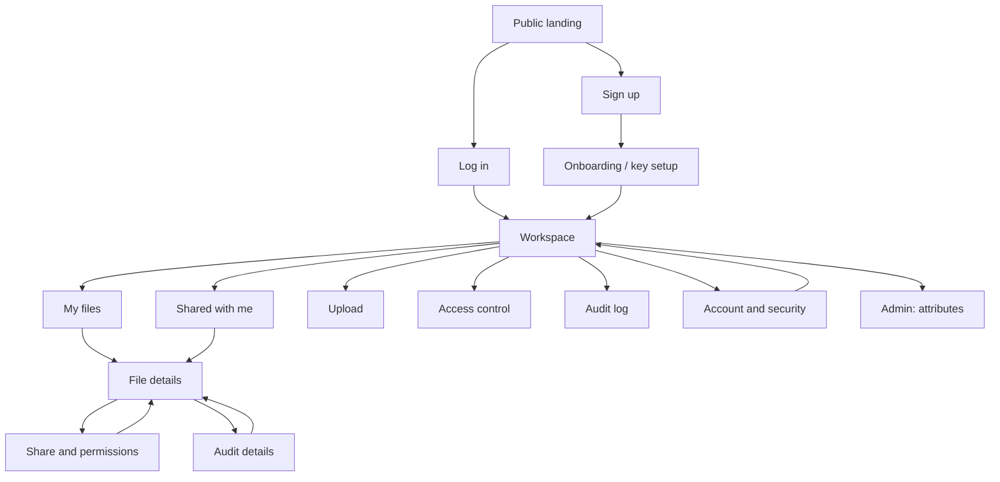
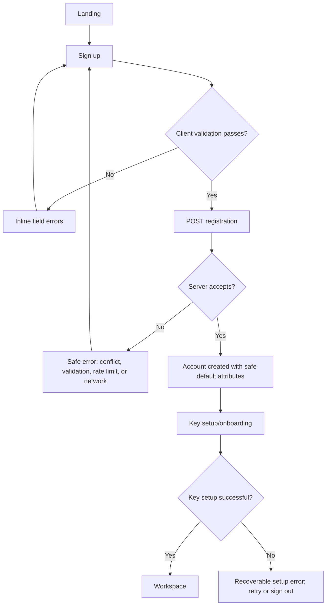
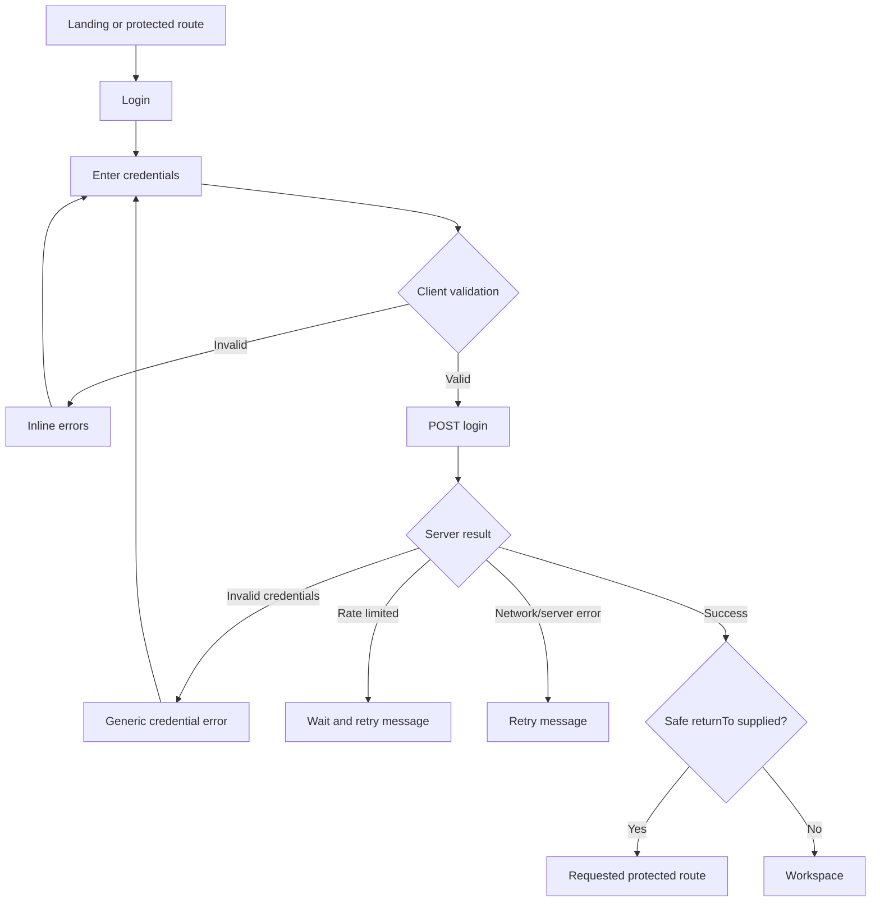

# DropSafe — App Flow and Navigation Specification

**Document:** `03-APP-FLOW.md`  
**Product:** DropSafe — *Your Files. Your Control.*  
**Related documents:** `01-PRD.md`, `02-TRD.md`  
**Status:** MVP navigation baseline  
**Design direction:** Premium, minimal monochrome workspace; responsive, accessible, progressive disclosure of security details.

## Purpose and conventions

This document defines screens, routes, role-based access, user journeys, and interaction states before UI implementation. Routes are proposed implementation names, not a requirement to expose every route publicly.

- **Public route:** accessible without an authenticated session.
- **Protected route:** requires an authenticated session and backend authorization.
- **Role-gated route/action:** requires a specific server-confirmed role or permission.
- **Client guard:** improves navigation UX only; it is not a security boundary.
- **Server authorization:** mandatory for every sensitive API call and object-level operation.
- **MVP:** the core file-sharing and audit-verification experience. Do not add unrelated features.

### Product behavior principles

1. Make file management simple by default; show detailed cryptographic and audit information when requested.
2. Never imply that a file is safe, verified, or blockchain-anchored unless the corresponding checks have actually passed.
3. Use default-deny authorization. The server checks ABAC eligibility and file-specific permissions.
4. Keep plaintext and unwrapped document keys in the browser only. The server manages metadata, policy decisions, wrapped keys, storage authorization, and audit state.
5. Revocation stops future authorization and URL issuance; it cannot erase copies already downloaded.
6. Public share links are a PRD requirement, but their exact decryption-secret delivery design is an open TRD decision. Do not implement a link that leaks a DEK in a query string. The link redemption UI must remain behind a clearly defined, security-reviewed design decision.

---

## 1. Application Navigation Overview

### 1.1 Main application areas

| Area | Purpose | Access |
|---|---|---|
| Public landing | Explain DropSafe and direct visitors to sign up or log in | Public |
| Authentication | Register, sign in, and end sessions | Public; login/register pages redirect signed-in users |
| Workspace | View owned and shared files; upload and download | Authenticated |
| File details | Inspect metadata, sharing state, and available actions | Authenticated plus resource-level authorization |
| Sharing | Share with registered recipients, configure permissions, create protected links, revoke access | Authenticated plus owner/share permissions |
| Access control | Review effective policy/eligibility and file-specific permissions | Authenticated; owner/admin-specific operations gated |
| Audit | Inspect events, verify integrity, inspect Merkle proofs and anchor status | Authenticated; detailed views subject to role/resource authorization |
| Administration | Assign trusted attributes and manage supported administrative settings | Admin/attribute-issuer role only |
| Account/security | Profile, public keys, key status, session actions, logout | Authenticated |
| Not found/denied | Explain unavailable or unauthorized navigation without leaking sensitive resource details | Public shell or authenticated shell as appropriate |

### 1.2 Primary navigation map



**Navigation note:** The diagram shows conceptual destinations. A user may access a destination only if the current session, role, ownership, ABAC policy, and file-specific permissions allow it.

---

## 2. User Roles and Permissions

Roles and attributes are not interchangeable. Roles grant application-level capabilities; ABAC attributes and file-specific grants govern resource operations.

| User type | Can do | Cannot do by default |
|---|---|---|
| Visitor | View landing page, open sign-up/login, redeem a valid protected share link after its security flow is finalized | Browse workspace, view private metadata, download protected files |
| Registered user / owner | Manage own account and keys; upload, list, download, and delete own files; inspect own shares; share files when policy allows; revoke own grants; inspect relevant audit history | Assign trusted attributes to self; bypass policy or file permissions |
| Registered recipient | View files shared with them, download/decrypt while eligible and permitted, inspect the share details exposed to recipients | Manage owner settings, grant themselves access, access another user's files |
| Administrator / attribute issuer | Use the dedicated admin area to assign supported trusted attributes and manage user attribute bindings | Read plaintext files or raw DEKs; silently change document ownership or bypass audit trails |
| Auditor (if enabled in MVP) | Inspect audit events and verify integrity/anchor proofs within assigned scope | Download files or mutate sharing/policies unless separately granted |
| Revoked/expired recipient | See a safe access-denied/expired state where appropriate | Obtain new download URLs or continue future access through revoked grants |

**Implementation note:** The PRD calls for a minimal administration interface and audit visibility. Treat the auditor role as optional until its exact scope is confirmed; an admin role must not automatically imply file-content access.

### Authorization rule

For a protected resource action:

1. Authenticate the session.
2. Load current server-side user/resource/share/policy state.
3. Evaluate ABAC eligibility (default deny).
4. Check the file-specific permission and resource ownership.
5. If allowed, perform the operation and record the relevant audit event.
6. If denied, return a safe response and do not issue storage credentials/URLs.

---

## 3. Complete Screen and Page Inventory

### 3.1 Public screens

| ID | Page | Route | Purpose | Roles | Main information/actions | Required data | States |
|---|---|---|---|---|---|---|---|
| P-01 | Landing | `/` | Explain the product and route visitors into the app | Visitor; signed-in user sees redirect or workspace CTA | Product value, concise security explanation; **Get started** → `/signup`; **Log in** → `/login` | Static content | Normal; navigation error |
| P-02 | Sign up | `/signup` | Create an account | Visitor | Email, password, confirm password if chosen; submit; link to login | None before submit | Idle, validating, submitting, field errors, account conflict, network error, success |
| P-03 | Log in | `/login` | Authenticate | Visitor | Email/password; submit; **Forgot password?** only if recovery is implemented; link to signup | None before submit | Idle, submitting, invalid credentials, rate-limited, network error, success |
| P-04 | Protected-link entry | `/s/:token` | Start protected share-link flow | Visitor or authenticated user | Generic link status, expiry/permission summary only after safe validation; continue/redeem action | Link token; server validation; key delivery depends on unresolved design | Loading, valid, expired, revoked, invalid, rate-limited; no secret leakage |
| P-05 | Not found | `*` | Explain unknown route | All | Safe not-found message; return home or workspace based on session | None | Normal |

### 3.2 Authenticated workspace screens

| ID | Page | Route | Purpose | Roles | Main information/actions | Required data | States |
|---|---|---|---|---|---|---|---|
| A-01 | Workspace overview | `/app` | Default signed-in landing page | Authenticated | File summary, recent items if available, upload CTA, quick links | Session, counts/list summaries | Loading, empty, error, populated |
| A-02 | My files | `/app/files` | Browse owned files | Authenticated owner | File list, encrypted status, version, share indicator; upload, open details, download, delete | Owned document metadata and current versions | Loading, empty, error, populated |
| A-03 | Shared with me | `/app/shared` | Browse files shared with current user | Authenticated recipient | Shared file list, owner, permission/expiry status; open details/download | Current shares, eligibility status | Loading, empty, error, populated, expired/revoked |
| A-04 | Upload file | `/app/upload` | Encrypt and upload a file | Authenticated user | File picker/drop zone, progress, cancel/retry, security status | Session, file metadata, upload intent, object storage URL | Idle, encrypting, uploading, finalizing, success, cancelled, failure |
| A-05 | File details | `/app/files/:documentId` | Inspect one file and allowed actions | Authenticated user with resource access | Metadata, version, integrity status, owner, sharing state; download, share, access, audit, delete if allowed | Authorized document/version metadata, signed manifest details | Loading, denied/not-found, verification pending, verified, verification failed, error |
| A-06 | Share management | `/app/files/:documentId/sharing` | Manage recipient grants and protected links | Owner or explicitly authorized sharer | Recipient search/select, permission options, expiry, current grants, revoke, protected-link creation | Current policy/eligibility, recipient signed key bindings, existing grants | Loading, no shares, validating, saving, success, conflict/denial, error |
| A-07 | Access control | `/app/files/:documentId/access` | Review effective access and permissions | Owner; admin where policy management is allowed | Eligible recipients, policy summary, file-level permissions, denial explanation appropriate to viewer | Policy, resource attributes, shares, current eligibility | Loading, empty, denied, policy error, populated |
| A-08 | Audit log | `/app/audit` | Browse authorized audit events | Authenticated; scope filtered by server | Event timeline, actor/action/result, anchor status, filters/pagination | Authorized audit event page | Loading, empty, error, populated |
| A-09 | Audit event detail | `/app/audit/:eventId` | Inspect an event and verify its integrity | Authorized user/auditor | Canonical event fields safe for display, hash-chain status, batch/root, proof status | Event and proof metadata | Loading, not found/denied, pending anchor, verified, verification failed, error |
| A-10 | Audit batch detail | `/app/audit/batches/:batchId` | Inspect Merkle batch and blockchain anchor | Authorized user/auditor | Root, sequence range, chain/network, contract, transaction/block, proof controls | Batch and anchor status; proof data | Pending, anchored, failed/retrying, proof valid/invalid, error |
| A-11 | Account & security | `/app/account` | Manage profile and inspect key/session status | Authenticated | Account details, public-key fingerprints/status, key backup guidance if implemented, logout | Current user and registered public keys | Loading, no keys, key setup needed, populated, error |
| A-12 | Admin attributes | `/app/admin/attributes` | Assign trusted attributes | Admin/attribute issuer only | User lookup, allowed attribute values, binding version/signature status, save | Admin session, target user, attribute schema/issuer | Loading, forbidden, validation error, saving, success, error |
| A-13 | Admin user detail (optional) | `/app/admin/users/:userId` | Review a user's account/attribute binding | Admin only if included | Minimal account status, attributes and key binding; supported administrative actions only | User record and signed binding | Loading, forbidden, not found, error |

**Inventory notes**
- “File details” is a resource view, not proof of authorization. The API must re-authorize each action independently.
- If the PRD's audit requirements can be met by a single page with inline proof expansion, separate event/batch detail routes may be implemented as drawers instead. Keep the user journey equivalent.
- Do not add folders, starred files, search, recycle bin, email verification, or password recovery unless the PRD is updated to include them.

---

## 4. Route Definitions

### 4.1 Route map

```text
Public
/                           Landing
/signup                     Sign up
/login                      Log in
/s/:token                   Protected share-link entry (security design pending)

Authenticated
/app                        Workspace overview
/app/files                  My files
/app/shared                 Shared with me
/app/upload                 Upload
/app/files/:documentId      File details
/app/files/:documentId/sharing
                            Share management
/app/files/:documentId/access
                            Access control
/app/audit                  Audit log
/app/audit/:eventId         Audit event detail
/app/audit/batches/:batchId Audit batch detail
/app/account                Account & security

Role-gated
/app/admin/attributes       Attribute administration
/app/admin/users/:userId    Optional admin user detail

Fallback
/*                          Not found
```

### 4.2 Route guard rules

| Rule | Behavior |
|---|---|
| Visitor opens a protected `/app/...` route | Redirect to `/login?returnTo=<safe-relative-path>` |
| Login succeeds with valid `returnTo` | Redirect to that safe internal route; otherwise `/app` |
| Visitor opens `/login` or `/signup` while authenticated | Redirect to `/app`, unless an intentional sign-out flow is in progress |
| Authenticated user opens an admin route without required role | Show `/app/forbidden` or an inline 403 page; do not reveal admin data |
| User opens a file route without resource permission | Show generic unavailable/denied page; avoid confirming a private resource exists |
| Session expires while viewing a protected route | Preserve a safe return path, clear local authenticated state, redirect to login with a session-expired notice |
| API returns 401 | Attempt the documented refresh flow once if supported; otherwise clear session and redirect to login |
| API returns 403 | Stay in app and show a safe permission-denied state; do not loop to login |
| API returns 404 for an inaccessible resource | Show generic “File unavailable” state; follow server policy to avoid IDOR information leaks |
| Unknown route | Show not-found with **Go to workspace** for authenticated users or **Home** for visitors |
| Unsafe/external `returnTo` | Ignore it and redirect to `/app` after login |

Do not encode secrets, access tokens, or decryption keys in route parameters or query strings.

### 4.3 Recommended implementation note

The route table is the navigation contract. Define routes centrally and keep route labels/links consistent. Client-side role checks are for hiding unavailable navigation; APIs must still authorize every action.

---

## 5. Global Navigation Structure

### 5.1 Desktop

**Authenticated shell**
- Left sidebar: DropSafe logo/tagline, Workspace, My files, Shared with me, Upload, Audit log.
- Bottom/secondary area: Account & security; Admin attributes shown only for authorized admins.
- Main header: current page title, optional breadcrumb, primary page action, account menu.
- Content: page-specific view with consistent widths and spacing.
- Security status: concise status badge by a file or audit event; detailed explanation available on demand.

### 5.2 Navigation behavior

| Element | Behavior |
|---|---|
| Logo | Public: `/`; authenticated: `/app` |
| Workspace | `/app` |
| My files | `/app/files` |
| Shared with me | `/app/shared` |
| Upload | `/app/upload` |
| Audit log | `/app/audit` |
| Account & security | `/app/account` |
| Admin attributes | `/app/admin/attributes`, only for admin/attribute issuer |
| File row/card | Open `/app/files/:documentId` |
| Breadcrumb | Navigate to the parent view without losing unrelated state |
| Account menu → Log out | Perform logout request, clear client session state, navigate to `/` |
| Back button | Preserve reasonable list state where possible; always re-check server authorization |

Avoid duplicate top-level links. Do not show controls the current user cannot use unless there is a clear disabled-state explanation.

---

## 6. First-Time Visitor Experience

1. Visitor opens `/`.
2. Landing page communicates encrypted files, controlled sharing, and verifiable activity without unsupported guarantees.
3. **Get started** navigates to `/signup`; **Log in** navigates to `/login`.
4. Visitor submits registration form.
5. Backend validates and creates the account; it assigns safe default attributes. Users cannot set privileged attributes during registration.
6. The app starts the key-setup/onboarding step only when the key-generation/protection workflow is implemented and specified.
7. The user creates or registers separate encryption and signing key pairs; private keys are protected locally before export/persistence. Public-key/attribute binding is authenticated by the issuer.
8. On success, navigate to `/app` and show a concise “You're ready” confirmation.
9. If key setup fails, keep the user in the setup flow with a recoverable error; do not pretend sharing is ready if keys are missing.
10. If key setup is deferred for an early vertical slice, allow only features that are safe without keys and clearly mark secure sharing/upload as not ready. Do not silently skip cryptographic setup in the final MVP.

**Open product detail:** The PRD does not fully specify whether key setup happens immediately after signup or at first encrypted upload. Recommended baseline: run key setup after registration and before enabling encrypted upload/sharing, with clear key-loss warnings.

---

## 7. Authentication Flow

### 7.1 Signup



### 7.2 Login



### 7.3 Logout

1. User chooses **Log out** from the account menu.
2. UI optionally confirms if an upload or key-sensitive operation is in progress.
3. Client calls the logout endpoint to invalidate the session/refresh credential where supported.
4. Client clears in-memory auth state and sensitive transient state.
5. Navigate to `/`.
6. If the network is unavailable, clear local session state regardless; show a safe notice if server-side revocation could not be confirmed, and rely on short token/session lifetimes.

### 7.4 Authentication edge cases

| Scenario | Expected behavior |
|---|---|
| Invalid email format | Inline validation before request |
| Invalid credentials | Generic “Email or password is incorrect” message |
| Account already exists | Safe registration conflict message; do not expose unnecessary account details |
| Rate limited | Explain that the user should wait before retrying; avoid countdowns that imply exact backend state unless supplied |
| Server unavailable | Preserve non-secret form values where safe and allow retry |
| Session expired | Save safe relative return path, clear auth state, redirect to login |
| Refresh fails | Clear auth state and redirect to login; do not retry indefinitely |
| Direct protected-route access | Login with safe `returnTo` |
| External return URL | Reject; use `/app` |
| Password recovery | Not included unless added to PRD; do not show a nonfunctional link |
| Email verification | Not included unless added to PRD; do not show a nonfunctional step |
| Key setup fails | Keep account status clear; block key-dependent actions until setup succeeds |
| User logs out in another tab | Sync local UI logout where practical; server remains authoritative |

---

## 8. Onboarding Flow

**Recommended MVP onboarding**
1. Registration success → key setup explanation.
2. Explain that encryption and signing keys serve different purposes.
3. Generate separate encryption and signing key pairs using supported browser cryptography.
4. Protect private key material using the agreed local protection/export design.
5. Register public keys with the backend.
6. Verify that the returned key/attribute binding is signed by the trusted issuer.
7. Show key fingerprints and recovery guidance; do not imply recovery is possible unless implemented.
8. Continue to `/app`.

**Navigation rules**
- **Continue** → next setup step only after current step succeeds.
- **Retry** → rerun only the failed step where safe; do not silently generate replacement keys and lose access to existing files.
- **Back** → previous explanation/input step, not a destructive key regeneration.
- **Cancel setup** → sign out or leave a clearly marked incomplete setup state; do not enable encrypted sharing.
- **Replace keys** → not a casual onboarding action; requires a separate migration/recovery design.

**Required states:** unsupported browser/API, generation failure, registration failure, issuer signature verification failure, duplicate key, lost connection, and successful setup.

---

## 9. Core User Journey 1 — Upload and Encrypt a File

**Starting point:** Authenticated user on `/app`, `/app/files`, or `/app/upload`.

1. User selects **Upload**.
2. App navigates to `/app/upload` or opens the upload panel on that route.
3. User selects or drops a file; client validates the file selection and configured size limit.
4. UI displays the filename and size locally; it does not send file bytes to FastAPI.
5. User selects **Encrypt and upload**.
6. Browser generates a random DEK and encrypts chunks using AES-256-GCM. Each chunk uses a unique nonce and AAD binding the document ID/version/chunk index/final-chunk state.
7. Client creates a manifest and a signed document commitment using the owner signing key.
8. Client requests an upload intent. Backend authenticates, validates metadata/limits, and returns short-lived URLs scoped to the expected ciphertext objects.
9. Browser uploads ciphertext directly to object storage and reports progress.
10. Client finalizes the upload with the encrypted manifest, chunk metadata, digest, signature, and version information.
11. Backend validates expected metadata, stores the version, and records the audit event/outbox job.
12. UI shows success and navigates to `/app/files/:documentId`.

**Data changes:** New document metadata, encrypted object chunks, manifest/version record, owner signature, audit event, and pending audit batch/anchor state.

**Success condition:** Ciphertext is stored, the manifest/version is finalized, the signature is recorded, and the UI distinguishes “uploaded” from “audit anchor confirmed.”

**Failure paths**
- Unsupported browser cryptography → block operation with a browser compatibility message.
- File exceeds limit → reject before encryption/upload.
- Encryption fails → discard temporary buffers as far as practical; do not upload a partial file as complete.
- Upload URL expires/network interruption → request a new authorized intent and retry failed chunks only if the protocol supports safe retry.
- Storage failure → show retry/cancel; do not finalize incomplete content.
- Finalization response lost → query the upload/document status or retry idempotently; avoid duplicate versions.
- Signature/manifest mismatch → reject finalization and retain a safe diagnostic ID.
- Audit worker or blockchain unavailable → file upload may succeed; show audit as pending/retrying.
- User navigates away → warn if operation is active; define cancel cleanup for orphaned ciphertext.

---

## 10. Core User Journey 2 — Share and Download a File

### 10.1 Owner shares with a registered recipient

**Starting point:** Owner opens `/app/files/:documentId`.

1. User selects **Share** → `/app/files/:documentId/sharing`.
2. UI loads current shares, effective policy summary, and recipient eligibility results.
3. Owner selects a registered recipient and the permitted file actions/expiry.
4. Client fetches the recipient's authenticated public-key/attribute binding.
5. Client verifies issuer signature, user identity, key fingerprint/status, and current attributes.
6. Client checks eligibility according to the agreed policy protocol. The backend independently enforces policy when the share is created and when it is used.
7. If eligible, the owner's browser wraps the DEK to the recipient's public encryption key.
8. Client submits the share grant and wrapped DEK to the API.
9. Backend re-evaluates current ABAC and file permissions, persists the grant/wrapped key, and records an audit event.
10. UI shows the recipient, permissions, expiry, and current status.

**Recipient journey**
1. Recipient logs in and opens `/app/shared`.
2. Recipient selects the file.
3. Backend checks session, current eligibility, share status, expiry, and requested permission.
4. If allowed, backend returns metadata and short-lived ciphertext download URL(s).
5. Browser downloads ciphertext, retrieves the recipient-wrapped DEK, and unwraps it locally.
6. Client checks current version, verifies owner signature/manifest and chunk authentication, then decrypts.
7. UI reports verified/decrypted status only after successful checks.

**Success condition:** Only an eligible, authorized recipient obtains the wrapped DEK and ciphertext; integrity checks pass before the file is presented as successfully decrypted.

**Failure paths**
- Recipient not eligible → no key wrapping/share creation; show a safe explanation to the owner.
- Missing/invalid signed key binding → block sharing and request recipient key setup/administrative correction.
- Policy changes between selection and submission → backend rejects; refresh eligibility and ask owner to retry.
- Recipient share revoked/expired → deny new access and URL issuance.
- Wrapped key missing or wrong key version → fail safely; do not try unrelated private keys silently.
- Signature, digest, AAD, or GCM authentication failure → stop decryption and display integrity verification failure.
- Storage URL expires → request a new authorization check and URL.
- Audit anchor delayed → allow authorized file operation if policy permits; label anchor pending.

### 10.2 Protected shareable link

Protected links are a required product journey, but implementation is **blocked on the TRD's open key-delivery decision**. Do not ship a link flow that places a raw DEK in a query string or logs a secret.

Proposed high-level route only:
1. Owner opens Share management and chooses **Create protected link**.
2. UI explains scope, expiry, and limitations.
3. System creates a high-entropy token, stores only its hash, and associates the link with a specific document/version/permission.
4. Owner receives a copyable link; the UI warns the link can be forwarded and explains expiry/revocation.
5. Recipient opens `/s/:token`; server validates status/expiry/rate limits without exposing sensitive file metadata prematurely.
6. The recipient completes the selected, reviewed authentication/key-delivery step.
7. API checks link status and policy; ciphertext download and client-side decryption follow the reviewed design.
8. Owner can revoke the link from the sharing page.

Until step 6's design is approved, the create-link action must be disabled or clearly marked “not available yet” in development builds.

---

## 11. Additional Important User Journeys

### 11.1 Revoke a registered recipient

1. Owner opens File details → Share management.
2. Selects a current grant and chooses **Revoke access**.
3. Confirmation dialog explains that future access is blocked, but already-downloaded copies cannot be erased.
4. Owner confirms.
5. Backend atomically marks the grant revoked and records an audit event.
6. UI updates the share status and removes future access controls.
7. Recipient's next request is denied; no new presigned URL is issued.

**Failure:** If the server cannot confirm revocation, keep the UI in a pending/error state; do not show “revoked” until persisted. Previously issued URLs may remain valid until expiry.

### 11.2 Delete an owned file

1. Owner chooses **Delete** from File details.
2. Confirmation explains the defined deletion behavior and sharing consequences.
3. Backend verifies ownership/permission and marks the document deleted or starts the documented deletion workflow.
4. New downloads/shares are blocked and an audit event is recorded.
5. UI returns to `/app/files` and shows confirmation.

**Open dependency:** Finalize hard-delete versus soft-delete behavior before enabling this control. Do not promise immediate permanent erasure unless object deletion is confirmed.

### 11.3 Inspect audit integrity

1. User opens `/app/audit`.
2. Selects an event or batch.
3. UI shows whether the event is local-only, queued, anchored, or verified.
4. User chooses **Verify integrity**.
5. Client or API verifies the hash-chain/Merkle inclusion data and, where required, checks the expected chain/contract root.
6. UI reports **Verified**, **Pending**, or **Verification failed** with a concise explanation and details on demand.

**Success:** The proof is checked against the correct batch root and expected chain/contract. “Transaction exists” alone is not a valid proof-verification result.

### 11.4 Admin assigns trusted attributes

1. Authorized admin opens `/app/admin/attributes`.
2. Searches/selects a user and sees only fields necessary for administration.
3. Chooses values from the allowed attribute schema.
4. Reviews the change and confirms.
5. Backend checks role, validates values, updates the attribute binding, signs/version-controls it, and records an audit event.
6. UI shows the new binding version/status.

**Failure:** Non-admin gets forbidden state; invalid attributes are rejected; issuer signing failure must not display a successful assignment.

### 11.5 Session expiration during a sensitive action

1. API returns 401 while a user is uploading, sharing, or viewing audit data.
2. Client attempts one refresh if the configured session design supports it.
3. If refresh fails, clear local session state and stop initiating new requests.
4. Preserve safe resumable progress metadata only; never persist plaintext keys or raw tokens to resume.
5. Redirect to login with a safe return path where appropriate.
6. After re-authentication, re-check current policy and share state before resuming any action.

---

## 12. Page-to-Page Navigation Rules

| From | Action | To | Conditions |
|---|---|---|---|
| Landing | Get started | `/signup` | Visitor |
| Landing | Log in | `/login` | Visitor |
| Signup | Account created | Key setup/onboarding, then `/app` | Only after successful required setup |
| Signup | Already have an account | `/login` | Always |
| Login | Successful authentication | Safe `returnTo` or `/app` | Session valid |
| Workspace | My files | `/app/files` | Authenticated |
| Workspace | Shared with me | `/app/shared` | Authenticated |
| Workspace / My files | Upload | `/app/upload` | Authenticated and key setup complete |
| My files / Shared with me | Select file | `/app/files/:documentId` | Server confirms access |
| File details | Share | `/app/files/:documentId/sharing` | Owner or authorized sharer |
| File details | Access control | `/app/files/:documentId/access` | Authorized viewer |
| File details | Audit details | `/app/audit` with safe resource filter or event route | Authorized scope |
| Share management | Cancel/back | File details | Do not discard an unsaved form without warning |
| Audit log | Select event | `/app/audit/:eventId` | Event within user's authorized scope |
| Audit event | Open batch | `/app/audit/batches/:batchId` | Batch exists and access allowed |
| Account | Logout | `/` | Always clear client auth state |
| Any protected route | Session invalid | `/login?returnTo=...` | Safe internal return path only |
| Any route | Unknown path | `*` | Contextual home/workspace link |
| Admin route | Insufficient role | Forbidden state | No admin data disclosed |

### Button behavior contract

- **Upload / Encrypt and upload:** validate → encrypt → upload ciphertext → finalize → show result; disable duplicate submission while in progress.
- **Download / Decrypt:** re-authorize → fetch ciphertext and wrapped key → verify signature/manifest → decrypt → report result.
- **Share:** validate recipient binding/eligibility → wrap key client-side → submit grant → show persisted status.
- **Revoke:** confirmation → server mutation → update UI only after confirmed response.
- **Delete:** confirmation → server mutation/deletion workflow → return to file list only after confirmed response.
- **Copy link:** only enabled after link creation succeeds; never copy an uncommitted/expired link.
- **Verify integrity:** show pending/progress state; report the precise result, not a generic green “secure” badge.
- **Logout:** revoke server session where possible, clear client state, navigate to public landing.
- **Cancel:** explain whether work is discarded and whether orphaned ciphertext cleanup is pending.

---

## 13. Modal, Drawer, and Overlay Interactions

Use overlays only for short, contextual decisions. Full workflows belong on their own route.

| Overlay | Trigger | Content | Actions/results |
|---|---|---|---|
| Upload progress panel | Upload begins | Stage, progress, cancel/retry | Cancel follows cleanup behavior; success links to File details |
| Share recipient picker | Share page → Add recipient | Search/select registered user, eligibility status | Confirm continues to permission setup; invalid key blocks share |
| Revoke confirmation | Revoke grant/link | Consequences and downloaded-copy limitation | Confirm revokes; Cancel closes without mutation |
| Delete confirmation | Delete file | Deletion semantics and impact on shares | Confirm starts documented deletion; Cancel closes |
| Security details drawer | Click status badge/details | Algorithm, version, signature and audit status with careful wording | Close returns to same page and state |
| Audit proof drawer (optional) | View proof from event/batch | Merkle path, root, chain/contract, verification outcome | Close returns to event/batch |
| Unsaved-changes dialog | Navigate away with edited policy/share form | Explain discarded edits | Stay or discard |
| Session-expired notice | Session expires | Explain sign-in requirement | Sign in and return safely |
| Key-loss warning | Before key export/reset/replacement | Explain irrecoverability risk and current recovery support | Continue only after explicit confirmation |

**Accessibility:** Dialogs need accessible names, focus trapping, Escape behavior where safe, focus restoration, keyboard navigation, and no reliance on color alone.

---

## 14. Empty States

Every empty state must explain what is empty and offer a relevant next action when permitted.

| Page | Empty state | Primary action |
|---|---|---|
| Workspace | “Your secure workspace is ready.” | Upload a file |
| My files | “No files uploaded yet.” | Upload file |
| Shared with me | “Files shared with you will appear here.” | No action or return to workspace |
| Upload | “Choose a file to begin.” | Select file |
| File sharing | “You haven’t shared this file yet.” | Share with a registered recipient |
| Protected links | “No active links.” | Create link only after link-security design is implemented |
| Access control | “No active recipient grants.” | Open Share management if owner |
| Audit log | “No audit events yet.” | Return to workspace or perform a supported action |
| Audit batch list | “No batches anchored yet.” | Explain that events may still be queued |
| Account keys | “Key setup is incomplete.” | Continue key setup |
| Admin attributes | No matching user/attribute results | Refine the query or select a user |

Do not show an empty state when data failed to load; show an error with retry instead.

---

## 15. Loading States

| Context | Expected behavior |
|---|---|
| Initial route/session check | Neutral shell/skeleton; avoid flashing protected content before auth state is known |
| File list | Skeleton rows/cards; preserve layout to reduce visual shift |
| File details | Load authorized metadata first; do not show stale private metadata after a 403/404 |
| Upload encryption | Stage indicator; explain local encryption; allow cancel only if cleanup semantics are defined |
| Ciphertext upload | Progress when available; distinguish encryption progress from network upload progress |
| Finalizing upload | Indeterminate progress; prevent duplicate finalization |
| Share recipient eligibility | Show checking state; do not treat unknown eligibility as eligible |
| Saving share/revocation/deletion | Disable duplicate mutation; show confirmed result only after API success |
| Audit verification | Distinguish local proof calculation from RPC lookup/confirmation |
| Blockchain anchoring | Show queued/pending/retrying/anchored/failed states |
| Session refresh | Brief neutral state; retry once only |
| Key generation | Explain operation and failure recovery; never regenerate existing keys silently |

Respect reduced-motion preferences and use accessible progress labels. Do not rely on animation as the only status indicator.

---

## 16. Error States

| Error | User-facing behavior | Navigation/recovery |
|---|---|---|
| Network unavailable | “Couldn’t connect. Check your connection and try again.” | Retry in place |
| 401/session expired | “Your session expired. Sign in to continue.” | Login with safe return path |
| 403/policy denied | “You don’t have permission to perform this action.” | Stay in context; no login loop |
| File unavailable (404 or concealed denial) | Generic unavailable message | Return to file list |
| Invalid/expired/revoked link | Generic safe link-unavailable state | Public landing or sign in if the flow requires it |
| Invalid file type/size | Explain supported limit/type policy | Return to picker |
| Encryption failure | “The file could not be encrypted. Nothing was finalized.” | Retry; do not mark uploaded |
| Upload failure | Identify failed stage without exposing signed URL | Retry failed safe stage or cancel |
| Signature/manifest failure | “Integrity verification failed. The file was not opened.” | Stop; offer report/reference ID |
| GCM authentication failure | Do not expose plaintext; report verification failure | Stop and return to details |
| Recipient key invalid/untrusted | Block sharing and explain that recipient key verification failed | Ask recipient/admin to resolve key setup |
| Policy conflict | “Access rules changed. Refresh and try again.” | Reload eligibility/policy |
| Audit anchor pending | “Audit anchor is pending; verification is not complete.” | Retry status check later |
| Audit proof invalid | “The audit proof could not be verified.” | Show details; never label as verified |
| Server error | Safe generic message plus request ID | Retry or return to workspace |
| Rate limited | Ask user to wait before retrying | Disable rapid repeated attempts |
| Admin forbidden | “You don’t have access to this area.” | Return to workspace |

Never show stack traces, secrets, private policy internals, or raw storage credentials in user-facing errors.

---

## 17. Form Validation States

| Form | Client validation | Server validation and handling |
|---|---|---|
| Signup | Required email; valid email format; password policy; confirmation if present | Unique account, password policy, rate limit; safe conflict response |
| Login | Required fields; basic email format | Credential verification, rate limit; generic invalid-credential response |
| File selection | File present; configured size/type limits | Upload intent authorization and server-enforced limits |
| Share recipient | Recipient selected; permission selection valid; expiry valid | Recipient exists/eligible, current policy, owner permission, current key binding |
| Protected link | Expiry/scope selected; confirm warning | Token entropy/status, owner permission, policy, rate limit; only after link-secret design approval |
| Attribute assignment | Allowed attribute names/values; required target user | Admin role, valid schema, issuer/signature success, audit record |
| Policy edit (if exposed) | Valid structured policy fields; no arbitrary expressions | AST/schema validation, bounded complexity, authorized editor |
| Password recovery | Not included unless added to PRD | Do not expose a dead form/route |

Validation messages should be adjacent to the field, use text as well as color, and preserve safe user input after non-security errors. Never echo passwords, tokens, or key material into errors.

---

## 18. Redirect Rules

1. **Successful login:** safe `returnTo` if present; otherwise `/app`.
2. **Successful registration:** onboarding/key setup; then `/app`.
3. **Logout:** `/`.
4. **Unauthenticated protected route:** `/login?returnTo=<encoded-safe-relative-path>`.
5. **Expired session:** one refresh attempt if supported; otherwise clear session and redirect to login with safe return path.
6. **Authenticated visitor to `/login` or `/signup`:** `/app`.
7. **Insufficient role:** forbidden page/state; do not redirect to login.
8. **Resource denied/unavailable:** generic resource-unavailable state; do not reveal whether another user's private document exists.
9. **Invalid protected link:** safe link-unavailable page; no automatic file metadata disclosure.
10. **Unknown route:** public landing for visitors, workspace for authenticated users.
11. **External or protocol-relative return paths:** reject.
12. **Open redirect defense:** allow only normalized same-origin relative paths; reject `//host`, schemes, backslash ambiguity, and malformed encodings.
13. **Upload in progress:** navigation prompts before leaving when leaving would interrupt work.
14. **Unsaved share/policy form:** confirm before discarding edits.
15. **Verification failure:** remain on the details/verification context; never redirect to a success page.

---

## 19. Mobile Navigation Behavior

- Use a compact top bar with logo and an accessible menu button; the navigation opens a drawer/sheet.
- Keep primary destinations reachable: My files, Shared with me, Upload, Audit, Account. Admin navigation appears only for authorized users.
- On narrow screens, use a full-width file list or stacked cards rather than a dense desktop table.
- File details should use vertically stacked sections; security metadata may expand into accordions/drawers.
- Upload drop zone remains available, but a visible file-picker button is required for touch devices.
- Progress, errors, and verification status must remain visible without hover.
- Dialogs become full-height sheets where needed; preserve focus management and safe close behavior.
- Avoid swipe-only actions for delete/revoke; provide explicit buttons and confirmation.
- Do not rely on color, animation, or hover to communicate security state.
- Respect reduced motion, keyboard navigation, zoom, and accessible labels.
- Ensure long filenames, hashes, and transaction IDs wrap or have copy controls without breaking layout.

---

## 20. Unusual Scenarios and Edge Cases

| Scenario | Required behavior |
|---|---|
| User has no registered key pair | Allow account access but block encrypted upload/sharing until setup succeeds |
| Browser lacks required Web Crypto capability | Explain compatibility requirement; do not fall back to insecure crypto |
| Browser tab closes during upload | Do not mark incomplete content finalized; on next visit show recoverable/failed upload state only if persisted safely |
| Duplicate upload-finalize request | Idempotent result or conflict handling; no accidental duplicate versions |
| User double-clicks Share/Delete/Revoke | Disable duplicate submit and make backend mutation idempotent where practical |
| Policy changes during share flow | Re-evaluate at commit/use time; reject stale assumptions |
| Recipient key rotates | Old wrapped keys may not work with new key; define migration/rewrap workflow and show key-version mismatch |
| Recipient attribute changes | Re-evaluate future access according to policy; document whether existing shares become unusable immediately |
| Owner loses private key | Do not fabricate recovery; show documented recovery/unrecoverability guidance |
| User is removed/deactivated | Deny new requests; define what happens to owned documents and existing shares in admin policy |
| Revoked share with previously issued URL | Deny new URLs; old URL may remain usable until expiry |
| Deleted object remains in storage | Show deletion pending until object deletion/retention behavior is confirmed |
| Audit worker offline | Keep events in durable outbox; show pending state and retry later |
| RPC outage or testnet issue | File operations remain available; anchor shows pending/retrying |
| Local chain reset | Mark prior local anchors as belonging to the old chain instance; redeploy/re-anchor for the new demo session |
| Merkle proof missing | Show unverified/pending; never infer success from transaction existence |
| Audit event order changes | Verification fails or reconciliation flags inconsistency |
| Presigned URL accidentally appears in logs | Treat as a security incident; redact future logs and shorten URL expiry; assess revocation options |
| API returns inconsistent metadata | Stop verification/decryption and show safe integrity error |
| User opens same account in two tabs | Synchronize logout/session expiry state where practical; server checks remain authoritative |
| Public link is forwarded | Enforce configured link scope/expiry; explain that bearer links can be forwarded; revoke if necessary |
| Share-link token is guessed repeatedly | Rate-limit and return generic errors without leaking token validity details |
| User loses network during revocation | Do not show confirmed revoked state until server confirms; refresh status when online |
| User attempts admin route manually | Server role check denies access regardless of frontend navigation |
| Large file exhausts memory | Cancel safely, avoid duplicate full-file buffers, and enforce tested file/chunk limits |
| Anchor transaction reverts | Mark failed/retryable; do not label batch anchored |
| User requests a feature not in PRD | Do not invent a route; update PRD and this flow document first |

---

## Implementation handoff checklist

Before UI implementation:
- [ ] Confirm route names and the authenticated shell.
- [ ] Define exact role/permission matrix with the backend API.
- [ ] Decide whether onboarding key setup occurs after signup or at first upload.
- [ ] Resolve protected-link key delivery before enabling link creation/redemption.
- [ ] Choose the session model and define refresh/CSRF behavior.
- [ ] Finalize hard-delete versus soft-delete behavior.
- [ ] Decide whether auditor is a separate role or whether owners see only their own audit events.
- [ ] Map each page state to loading, empty, success, denied, and error UI.
- [ ] Add route-level and API-level tests for redirects and authorization.
- [ ] Validate responsive navigation and accessibility with keyboard and mobile layouts.
- [ ] Keep the PRD and TRD authoritative; do not implement unsupported features.

## Change control for AI-assisted development

Before adding or renaming a route, introducing a new role, changing a user journey, or enabling a security-sensitive button:
1. Check the PRD requirement and TRD trust boundary.
2. Update this document and the permission matrix.
3. Define success, failure, loading, and empty states.
4. Add route and API authorization tests.
5. Do not enable a UI action before its backend behavior and security requirements exist.
