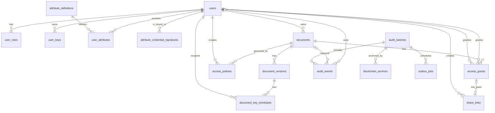

# DropSafe — Backend Schema and Data Architecture

**Document:** `05-BACKEND-SCHEMA.md`  
**Product:** DropSafe — *Your Files. Your Control.*  
**Working title:** *A Secure Cloud File-Sharing System Using Attribute-Based Access Control and Blockchain Auditing*  
**Status:** Proposed schema baseline for review before migrations are written  
**Related documents:** `01-PRD.md`, `02-TRD.md`, `03-APP-FLOW.md`, `04-UI-UX.md`

> **Important:** This is a schema and security blueprint, not migration code. It preserves the agreed stack: PostgreSQL, FastAPI, SQLAlchemy/Alembic, browser-side Web Crypto, Cloudflare R2-compatible object storage, ABAC, signed key/attribute bindings, audit hash chains, Merkle batching, and optional Ethereum Sepolia anchoring. Open decisions that materially affect the schema are listed in Section 24.

---

## 1. Database Architecture Overview

### 1.1 Recommended architecture

- **PostgreSQL** is the source of truth for user profiles, public-key directory metadata, document metadata, access grants, policies, audit records, Merkle batches, and blockchain anchor status.
- **Cloudflare R2** stores encrypted file objects only. The application database stores object keys and metadata, not file plaintext.
- **Browser Web Crypto API** encrypts file content and wraps document encryption keys for eligible recipients. The backend must not receive plaintext file content or raw document encryption keys.
- **FastAPI** validates inputs, authenticates requests, evaluates authorization, and mediates all protected database and object-storage operations.
- **SQLAlchemy + Alembic** manage ORM models and versioned schema migrations.
- A **background audit worker** batches audit events, calculates Merkle commitments, and retries anchor publication using an outbox-style state machine.
- **Hardhat local chain** is for development/testing; **Sepolia** may be used for a capstone demonstration. Blockchain availability must not gate normal file access.

### 1.2 Trust boundaries

1. The browser is responsible for client-side file encryption/decryption and recipient-side key wrapping/unwrapping.
2. The backend is trusted to enforce authentication, access policy, object retrieval, metadata access, rate limits, and audit recording—but must not be able to decrypt file content.
3. PostgreSQL stores authorization metadata and encrypted key envelopes. Treat database compromise as serious: it may expose metadata and access relationships even though file content remains encrypted.
4. R2 contains ciphertext objects. Presigned URLs are short-lived capabilities and must be scoped to one object and one operation.
5. Blockchain stores commitments/anchors, not private data, raw file names, recipient attributes, keys, or full audit payloads.
6. The attribute-authority signing key and user private keys must never be stored as plaintext in PostgreSQL.

### 1.3 Data design principles

- Use UUID primary keys for application entities unless a table benefits from a sequence number.
- Store timestamps in `timestamptz` and normalize API output to UTC.
- Use `jsonb` only for versioned policy expressions and carefully defined event payloads; prefer typed columns for core relationships.
- Use `text` or bounded `varchar` with explicit validation for labels and identifiers.
- Never trust user-supplied `owner_id`, `created_by`, role, attributes, object key, or audit status without server-side validation.
- Enforce tenant/user boundaries in every protected query. The frontend is not a security boundary.
- Use soft revocation/status fields for grants and key versions; avoid deleting audit history.
- Store hashes as `bytea` (fixed-length validated by the application/check constraint where practical) or canonical lowercase hex `text`. This document recommends `bytea` for internal SHA-256 values and hex strings at API boundaries.
- Do not put secrets, private keys, document keys, session tokens, raw share tokens, or presigned URLs in audit payloads or logs.

---

## 2. Entity Inventory

| Entity | Purpose | Record owner / authority | Sensitivity |
|---|---|---|---|
| `users` | Application identity/profile and account state | User; privileged account state changes are server/admin controlled | High |
| `user_roles` | Role assignments such as user/admin | Admin-controlled; server-enforced | High |
| `user_keys` | Public encryption/signing keys and lifecycle state | User owns key pair; server stores public keys only | High |
| `attribute_definitions` | Approved attribute names and allowed value types | Admin-controlled | High |
| `user_attributes` | Trusted attribute values assigned to users | Admin/attribute authority; not self-asserted | High |
| `attribute_credential_signatures` | Signature binding user identity, public-key fingerprint, and trusted attributes/version | Issuer/authority | High |
| `documents` | Logical file, owner, current version, metadata, lifecycle state | Document owner | High |
| `document_versions` | Immutable encrypted version metadata and object references | Document owner; created through authorized upload workflow | High |
| `document_key_envelopes` | Per-recipient wrapped document-key material for a version | Owner creates; recipient may retrieve only when authorized | Very high |
| `access_policies` | Versioned ABAC policy attached to a document or scope | Owner/admin according to product rules | High |
| `access_grants` | Explicit file permissions for users and/or link grants | Document owner or authorized manager | High |
| `share_links` | Hashed bearer token metadata for protected links | Creator/owner | Very high |
| `audit_events` | Append-only records of security-relevant actions | Created by backend/worker; not user-editable | High |
| `audit_batches` | Merkle root and batching metadata | Audit worker | High |
| `blockchain_anchors` | Transaction/chain status for a batch commitment | Audit worker; verified against chain | Medium/high |
| `outbox_jobs` | Reliable queue for audit batching/anchor retries | Backend/worker | High |

### Scope notes

- The model separates **ABAC eligibility** from **file-specific permissions**: a recipient must satisfy the trusted attribute policy and hold the relevant grant/permission.
- The model uses immutable document versions. Replacing a file creates a new version and new key envelopes; do not overwrite ciphertext in place.
- Share links are represented in the schema for the planned feature, but their use must remain disabled until the secure key-delivery design is approved. See Section 24.
- Refresh-token/session storage is not specified as a table yet because the TRD’s final session model is unresolved. If server-side refresh-token rotation/revocation is chosen, add a dedicated `user_sessions` table before implementation.

---

## 3. Relationship Diagram

**Relationship summary**
- User → documents: one-to-many.
- Document → versions: one-to-many.
- Version → key envelopes: one-to-many.
- User ↔ roles: many-to-many through `user_roles`.
- User ↔ attribute definitions: many-to-many through `user_attributes`, with one current value per definition per user in the baseline model.
- Document → access policies: one-to-many to preserve policy history; one active policy version per document is recommended.
- Document → grants: one-to-many.
- Audit batch → events: one-to-many; each event belongs to at most one batch.
- Audit batch → anchors: one-to-many, allowing retries or multiple chains/networks if explicitly supported.

---

## 4. Database Tables and Column Definitions

### Conventions

- `UUID` values should be generated by the backend or PostgreSQL UUID function consistently.
- `created_at` and `updated_at` are `timestamptz NOT NULL DEFAULT now()` unless specified otherwise.
- All foreign keys must have deliberate `ON DELETE` behavior.
- Do not use `ON DELETE CASCADE` on immutable audit records.
- Column types below are PostgreSQL types. Length/range checks should be enforced both at the API boundary and, where practical, in the database.

## 4.1 `users`

**Purpose:** Application identity and account status. Do not store passwords here if a dedicated auth provider is later selected; with the current FastAPI/Argon2id plan, store only a strong password hash.

| Column | Type | Null? | Default | Constraints / notes |
|---|---|---:|---|---|
| `id` | `uuid` | No | generated UUID | Primary key |
| `email` | `citext` or normalized `varchar(320)` | No | — | Unique; normalize before storing |
| `display_name` | `varchar(100)` | No | — | Trimmed; length validated |
| `password_hash` | `text` | Yes* | — | Argon2id hash only; nullable only if external auth is used |
| `status` | `varchar(20)` | No | `'active'` | Check: `active`, `disabled`, `pending` |
| `created_at` | `timestamptz` | No | `now()` | Immutable creation time |
| `updated_at` | `timestamptz` | No | `now()` | Updated by application/model hook |
| `disabled_at` | `timestamptz` | Yes | — | Set when account is disabled |

**Primary key:** `id`  
**Foreign keys:** None  
**Unique constraints:** Unique normalized email  
**Indexes:** Unique email index; `(status, created_at)` only if operational queries need it  
**Ownership:** A user may read/update permitted profile fields for their own account. Users cannot update their own status, roles, trusted attributes, or password hash directly through generic profile APIs.  
**Delete behavior:** Prefer disable/deactivate. Physical deletion requires a documented retention/anonymization process because historical audit records may refer to the user.

\*If using external authentication instead of local credentials, replace `password_hash` with an external subject identifier and define the provider contract before migration. Do not support two auth systems accidentally.

## 4.2 `user_roles`

**Purpose:** Assign coarse application roles. ABAC remains a separate policy layer; roles are not a substitute for per-document authorization.

| Column | Type | Null? | Default | Constraints / notes |
|---|---|---:|---|---|
| `user_id` | `uuid` | No | — | FK → `users.id` |
| `role` | `varchar(30)` | No | — | Check: `user`, `admin`; auditor role is unresolved |
| `assigned_by` | `uuid` | Yes | — | FK → `users.id`; null for controlled bootstrap if documented |
| `created_at` | `timestamptz` | No | `now()` | Assignment time |

**Primary key:** `(user_id, role)`  
**Foreign keys:** `user_id → users.id ON DELETE RESTRICT`; `assigned_by → users.id ON DELETE SET NULL`  
**Indexes:** `(role, user_id)`  
**Ownership:** Only authorized admin/bootstrap operations may assign privileged roles. A user cannot promote themselves by modifying request data.  
**Delete behavior:** Remove a role assignment explicitly; never cascade user deletion through audit data.

## 4.3 `user_keys`

**Purpose:** Directory of public encryption and signing keys. Store no private-key material.

| Column | Type | Null? | Default | Constraints / notes |
|---|---|---:|---|---|
| `id` | `uuid` | No | generated UUID | Primary key |
| `user_id` | `uuid` | No | — | FK → `users.id` |
| `key_purpose` | `varchar(20)` | No | — | Check: `encryption`, `signing` |
| `algorithm` | `varchar(40)` | No | — | Expected values include `RSA-OAEP-3072` or `ECDSA-P256` |
| `public_key_jwk` | `jsonb` | No | — | Public JWK only; validate allowed fields and algorithm |
| `public_key_fingerprint` | `bytea` | No | — | SHA-256 fingerprint of canonical public key representation |
| `key_version` | `integer` | No | `1` | Positive |
| `status` | `varchar(20)` | No | `'active'` | Check: `active`, `retired`, `revoked` |
| `created_at` | `timestamptz` | No | `now()` | — |
| `retired_at` | `timestamptz` | Yes | — | — |

**Primary key:** `id`  
**Foreign keys:** `user_id → users.id ON DELETE RESTRICT`  
**Unique constraints:** `(user_id, key_purpose, key_version)`; unique fingerprint per purpose if product rules require it  
**Indexes:** `(user_id, key_purpose, status)`; fingerprint index  
**Ownership:** User may register a new public key through a validated key-registration flow. The backend must validate structure/algorithm/size and bind it to the authenticated account. Public keys may be visible to authenticated users as needed for sharing.  
**Delete behavior:** Retire/revoke keys instead of deleting keys referenced by prior envelopes or signatures.

**Security rule:** Use separate key pairs for encryption and signing. Do not permit a client to overwrite a public key silently. Key changes must create a new version and be represented in signed/auditable records.

## 4.4 `attribute_definitions`

**Purpose:** Admin-managed schema for trusted user attributes used in ABAC decisions.

| Column | Type | Null? | Default | Constraints / notes |
|---|---|---:|---|---|
| `id` | `uuid` | No | generated UUID | Primary key |
| `name` | `varchar(80)` | No | — | Unique normalized identifier |
| `value_type` | `varchar(20)` | No | — | Check: `string`, `boolean`, `integer`, `string_set` |
| `allowed_values` | `jsonb` | Yes | — | Optional finite set/validation definition |
| `description` | `varchar(500)` | Yes | — | Admin-facing/help text |
| `is_active` | `boolean` | No | `true` | Inactive definitions cannot be newly assigned |
| `created_by` | `uuid` | No | — | FK → `users.id` |
| `created_at` | `timestamptz` | No | `now()` | — |
| `updated_at` | `timestamptz` | No | `now()` | — |

**Primary key:** `id`  
**Foreign keys:** `created_by → users.id ON DELETE RESTRICT`  
**Unique constraints:** Unique normalized `name`  
**Indexes:** `(is_active, name)`  
**Ownership:** Admin-only create/update/deactivate. Attribute names and allowed values must be validated server-side.  
**Delete behavior:** Deactivate rather than delete if referenced by assignments, signatures, or historical policy decisions.

## 4.5 `user_attributes`

**Purpose:** Store trusted attribute values assigned to users. Values must not be accepted as self-asserted claims from a regular user.

| Column | Type | Null? | Default | Constraints / notes |
|---|---|---:|---|---|
| `id` | `uuid` | No | generated UUID | Primary key |
| `user_id` | `uuid` | No | — | FK → `users.id` |
| `attribute_definition_id` | `uuid` | No | — | FK → `attribute_definitions.id` |
| `value` | `jsonb` | No | — | Shape validated against definition type |
| `assigned_by` | `uuid` | No | — | FK → `users.id` |
| `source` | `varchar(30)` | No | `'admin'` | Check against documented issuer sources |
| `valid_from` | `timestamptz` | No | `now()` | Start of validity |
| `valid_until` | `timestamptz` | Yes | — | Must be after `valid_from` |
| `created_at` | `timestamptz` | No | `now()` | — |

**Primary key:** `id`  
**Foreign keys:** User, definition, and assigning user FKs; use `RESTRICT` for user/definition references  
**Unique constraints:** Baseline assumes one current assignment per `(user_id, attribute_definition_id)`; if attribute history is required, use validity intervals and a partial unique constraint for one current assignment  
**Indexes:** `(user_id, attribute_definition_id)`; `(attribute_definition_id, valid_until)`  
**Ownership:** Admin/authority-managed. Users may be shown relevant attributes but cannot change trusted values.  
**Delete behavior:** Expire or replace assignments; preserve history where required for auditability.

**Important:** PostgreSQL cannot fully validate a dynamic `jsonb` value against another row’s `value_type` using a simple check constraint. Enforce this in a transaction/service layer and test it. Add database triggers only if there is a clear operational need.

## 4.6 `attribute_credential_signatures`

**Purpose:** Record issuer signatures binding a user identity, public-key fingerprint(s), attribute snapshot/version, and issue time. This supports the design requirement that clients can verify recipient identity/attributes before wrapping keys.

| Column | Type | Null? | Default | Constraints / notes |
|---|---|---:|---|---|
| `id` | `uuid` | No | generated UUID | Primary key |
| `user_id` | `uuid` | No | — | FK → `users.id` |
| `credential_version` | `integer` | No | — | Positive, monotonically increasing per user |
| `payload` | `jsonb` | No | — | Canonicalizable, versioned signed payload; no secrets |
| `payload_hash` | `bytea` | No | — | SHA-256 of canonical payload |
| `signature` | `bytea` | No | — | Issuer signature bytes |
| `issuer_key_id` | `varchar(120)` | No | — | Public identifier for issuer verification key |
| `status` | `varchar(20)` | No | `'active'` | Check: `active`, `superseded`, `revoked` |
| `issued_at` | `timestamptz` | No | `now()` | — |
| `expires_at` | `timestamptz` | Yes | — | Optional expiration |
| `created_at` | `timestamptz` | No | `now()` | — |

**Primary key:** `id`  
**Foreign keys:** `user_id → users.id ON DELETE RESTRICT`  
**Unique constraints:** `(user_id, credential_version)`  
**Indexes:** `(user_id, status, credential_version DESC)`; `issuer_key_id`  
**Ownership:** Issuer service creates and revokes credential records. Users may retrieve their credential and public verification information.  
**Delete behavior:** Never silently delete a credential used in authorization/audit history; supersede or revoke it.

**Security note:** The signed payload must define exactly which attributes and key fingerprints are covered. Use a versioned canonical representation (RFC 8785 or an equivalently specified deterministic encoding). Protect and rotate the issuer signing key; document compromise recovery.

## 4.7 `documents`

**Purpose:** Logical file record independent of its immutable encrypted versions.

| Column | Type | Null? | Default | Constraints / notes |
|---|---|---:|---|---|
| `id` | `uuid` | No | generated UUID | Primary key |
| `owner_id` | `uuid` | No | — | FK → `users.id` |
| `display_name` | `varchar(255)` | No | — | User-visible filename; sanitize for display |
| `media_type` | `varchar(150)` | Yes | — | Untrusted hint; do not rely on it for security |
| `current_version_id` | `uuid` | Yes | — | FK added after `document_versions`; must belong to this document |
| `status` | `varchar(20)` | No | `'active'` | Check: `active`, `deleted`, `quarantined` |
| `created_at` | `timestamptz` | No | `now()` | — |
| `updated_at` | `timestamptz` | No | `now()` | — |
| `deleted_at` | `timestamptz` | Yes | — | Soft-delete timestamp |

**Primary key:** `id`  
**Foreign keys:** `owner_id → users.id ON DELETE RESTRICT`; `current_version_id → document_versions.id ON DELETE RESTRICT` (add after version table exists)  
**Unique constraints:** None on display name; duplicate filenames are allowed  
**Indexes:** `(owner_id, status, updated_at DESC)`; `(owner_id, created_at DESC)`  
**Ownership:** Owner is assigned from the authenticated identity, never from an untrusted request field. Every read/update/delete must verify ownership or a currently valid grant and permission.  
**Delete behavior:** Soft-delete first. Object purge is a separate authorized background operation with retention rules. Preserve audit records.  
**Additional integrity rule:** Because `current_version_id` must refer to a version belonging to the same document, enforce this in the service layer and, preferably, with a composite FK/unique key after the final migration design is chosen.

## 4.8 `document_versions`

**Purpose:** Immutable metadata for each encrypted upload/version.

| Column | Type | Null? | Default | Constraints / notes |
|---|---|---:|---|---|
| `id` | `uuid` | No | generated UUID | Primary key |
| `document_id` | `uuid` | No | — | FK → `documents.id` |
| `version_number` | `integer` | No | — | Positive, unique per document |
| `key_version` | `integer` | No | — | Positive key lifecycle/version number |
| `object_key` | `varchar(512)` | No | — | Opaque R2 key; never client-controlled without server validation |
| `ciphertext_size_bytes` | `bigint` | No | — | `>= 0`; validate configured max upload size |
| `ciphertext_sha256` | `bytea` | No | — | 32-byte SHA-256 digest of complete ciphertext or defined manifest |
| `manifest` | `jsonb` | No | — | Versioned chunk metadata: chunk count, nonce references/encoding, lengths, AAD version; no plaintext |
| `signature` | `bytea` | Yes | — | Owner signature over canonical document commitment |
| `signature_algorithm` | `varchar(40)` | Yes | — | e.g. `ECDSA-P256`; required when signature exists |
| `signing_key_id` | `uuid` | Yes | — | FK → `user_keys.id`; must be a signing key owned by document owner |
| `commitment_version` | `varchar(30)` | No | `'v1'` | Canonical commitment format version |
| `created_by` | `uuid` | No | — | FK → `users.id` |
| `created_at` | `timestamptz` | No | `now()` | Immutable creation time |
| `retired_at` | `timestamptz` | Yes | — | Optional lifecycle marker |

**Primary key:** `id`  
**Foreign keys:** `document_id → documents.id ON DELETE RESTRICT`; `created_by → users.id ON DELETE RESTRICT`; `signing_key_id → user_keys.id ON DELETE RESTRICT`  
**Unique constraints:** `(document_id, version_number)`; unique `object_key`  
**Indexes:** `(document_id, version_number DESC)`; `ciphertext_sha256` only if integrity lookup use case requires it  
**Ownership:** Only the document owner or authorized upload workflow may create a version. Versions are immutable after finalization; incomplete uploads should use a separate upload-session table only if resumable/multipart uploads are added to scope.  
**Delete behavior:** Do not update a finalized object in place. New content creates a new version and fresh key envelopes. Purge is explicit and must account for grants/retention.

**Manifest requirements**
- Define a schema version and validate every field.
- Bind authenticated additional data to document ID, version, chunk index, and final-chunk flag.
- Use a unique nonce for every AES-GCM encryption under a given key.
- Do not store plaintext DEKs in the manifest.
- Avoid leaking unnecessary plaintext metadata such as original path or local filesystem structure.

## 4.9 `document_key_envelopes`

**Purpose:** Store a document key encrypted/wrapped for a specific recipient and document version. The backend stores ciphertext envelope bytes only.

| Column | Type | Null? | Default | Constraints / notes |
|---|---|---:|---|---|
| `id` | `uuid` | No | generated UUID | Primary key |
| `document_version_id` | `uuid` | No | — | FK → `document_versions.id` |
| `recipient_user_id` | `uuid` | No | — | FK → `users.id` |
| `recipient_encryption_key_id` | `uuid` | No | — | FK → `user_keys.id` |
| `wrapping_algorithm` | `varchar(40)` | No | — | Expected `RSA-OAEP-3072` for baseline |
| `wrapped_key` | `bytea` | No | — | Ciphertext envelope only; never plaintext key |
| `envelope_version` | `integer` | No | `1` | Positive |
| `status` | `varchar(20)` | No | `'active'` | Check: `active`, `revoked`, `superseded` |
| `created_by` | `uuid` | No | — | FK → `users.id`; must own the document or be authorized |
| `created_at` | `timestamptz` | No | `now()` | — |
| `revoked_at` | `timestamptz` | Yes | — | — |

**Primary key:** `id`  
**Foreign keys:** Version, recipient, recipient key, creator  
**Unique constraints:** `(document_version_id, recipient_user_id, recipient_encryption_key_id, envelope_version)`  
**Indexes:** `(recipient_user_id, status, created_at DESC)`; `(document_version_id, status)`  
**Ownership:** Owner creates envelopes client-side after independently verifying recipient eligibility and public-key/attribute credential signatures. Backend independently checks policy/grant conditions and refuses unauthorized envelope writes.  
**Delete behavior:** Mark revoked/superseded; do not assume deleting an envelope can revoke a key already downloaded by a recipient.

**Integrity checks**
- The recipient encryption key must belong to the recipient and be an active encryption key at creation time.
- The version must belong to the same document for which the creator is authorized.
- A document owner must not be able to create an envelope for an ineligible recipient simply by submitting an arbitrary user ID; server-side ABAC and grant checks are required.
- A malicious backend is part of the threat model: the owner’s browser must independently verify signed recipient information before wrapping the key.

## 4.10 `access_policies`

**Purpose:** Store versioned ABAC policy documents for a document. Policies are structured, versioned expressions—not arbitrary executable code.

| Column | Type | Null? | Default | Constraints / notes |
|---|---|---:|---|---|
| `id` | `uuid` | No | generated UUID | Primary key |
| `document_id` | `uuid` | No | — | FK → `documents.id` |
| `version_number` | `integer` | No | — | Positive, unique per document |
| `policy_schema_version` | `varchar(30)` | No | `'v1'` | Parser/schema version |
| `policy_ast` | `jsonb` | No | — | Validated allowlisted policy AST |
| `status` | `varchar(20)` | No | `'active'` | Check: `draft`, `active`, `superseded`, `disabled` |
| `created_by` | `uuid` | No | — | FK → `users.id` |
| `created_at` | `timestamptz` | No | `now()` | — |
| `activated_at` | `timestamptz` | Yes | — | — |

**Primary key:** `id`  
**Foreign keys:** `document_id → documents.id ON DELETE RESTRICT`; `created_by → users.id ON DELETE RESTRICT`  
**Unique constraints:** `(document_id, version_number)`  
**Indexes:** `(document_id, status, version_number DESC)`  
**Ownership:** Owner or explicitly authorized administrator may create/activate policy versions. Only one active policy version per document should exist; enforce with a partial unique index where `status = 'active'`.  
**Delete behavior:** Supersede/disable; preserve previous policy versions for audit context.

**Policy rules**
- Default deny.
- Use a strict allowlist of operators and attribute names.
- Bound AST depth, node count, string lengths, and evaluation time.
- Reject unknown attributes/operators.
- Never execute user-supplied code or evaluate arbitrary SQL from policy JSON.
- Record which policy version was evaluated for an authorization decision where useful.
- Policy eligibility does not itself grant every action; file-specific permissions must also allow the requested action.

## 4.11 `access_grants`

**Purpose:** Represent a file-specific grant to a registered user or a share-link grant. The table stores action permissions separately from ABAC eligibility.

| Column | Type | Null? | Default | Constraints / notes |
|---|---|---:|---|---|
| `id` | `uuid` | No | generated UUID | Primary key |
| `document_id` | `uuid` | No | — | FK → `documents.id` |
| `grantor_user_id` | `uuid` | No | — | FK → `users.id` |
| `grantee_user_id` | `uuid` | Yes | — | FK → `users.id`; null for link-only grant |
| `grant_type` | `varchar(20)` | No | `'user'` | Check: `user`, `link` |
| `permissions` | `jsonb` | No | — | Validated set such as `read`, `download`; no unsupported actions |
| `policy_version_id` | `uuid` | Yes | — | FK → `access_policies.id`; records relevant policy version at grant creation if applicable |
| `status` | `varchar(20)` | No | `'active'` | Check: `active`, `revoked`, `expired` |
| `expires_at` | `timestamptz` | Yes | — | Optional expiry |
| `created_at` | `timestamptz` | No | `now()` | — |
| `revoked_at` | `timestamptz` | Yes | — | — |
| `revocation_reason` | `varchar(300)` | Yes | — | Avoid storing sensitive detail |

**Primary key:** `id`  
**Foreign keys:** Document, grantor, optional grantee, optional policy version  
**Unique constraints:** A partial unique constraint for one active user grant per `(document_id, grantee_user_id)` may be appropriate; define behavior for multiple grants with different expiry/permissions before enforcing  
**Indexes:** `(document_id, status)`; `(grantee_user_id, status, created_at DESC)`; `(expires_at)` for expiry cleanup  
**Ownership:** Grantor must own the document or have a specifically defined delegation permission. The server verifies that the grantor is authorized, the grantee is eligible under the active policy, and requested permissions are allowed.  
**Delete behavior:** Revoke rather than delete.

**Permissions format:** Use a typed application schema and validate against a fixed allowlist. JSON is used for compactness, but invalid permission names must be rejected. If permissions become complex, normalize them into an `access_grant_permissions` child table rather than expanding free-form JSON.

## 4.12 `share_links`

**Purpose:** Store metadata for protected bearer links. This table must not contain a raw bearer token or raw document encryption key.

| Column | Type | Null? | Default | Constraints / notes |
|---|---|---:|---|---|
| `id` | `uuid` | No | generated UUID | Primary key |
| `access_grant_id` | `uuid` | No | — | FK → `access_grants.id`; grant must be `link` type |
| `created_by` | `uuid` | No | — | FK → `users.id` |
| `token_hash` | `bytea` | No | — | Hash of high-entropy random token; unique |
| `token_key_version` | `smallint` | No | `1` | Version for token-hash/derivation format if needed |
| `status` | `varchar(20)` | No | `'active'` | Check: `active`, `revoked`, `expired` |
| `expires_at` | `timestamptz` | No | — | Require expiry for the baseline protected-link design |
| `max_uses` | `integer` | Yes | — | Optional positive limit; define atomic use semantics before implementing |
| `use_count` | `integer` | No | `0` | Non-negative; increment atomically only after successful redemption as defined |
| `created_at` | `timestamptz` | No | `now()` | — |
| `revoked_at` | `timestamptz` | Yes | — | — |

**Primary key:** `id`  
**Foreign keys:** `access_grant_id → access_grants.id ON DELETE RESTRICT`; `created_by → users.id ON DELETE RESTRICT`  
**Unique constraints:** Unique `token_hash`  
**Indexes:** `(status, expires_at)`; `access_grant_id`  
**Ownership:** Only the grant creator/owner or authorized manager may revoke or inspect the link metadata. Redemption must be rate-limited and must not disclose resource existence to unauthorized requesters.  
**Delete behavior:** Revoke/expire. Preserve enough audit metadata to investigate abuse.

**Critical unresolved design:** The browser must obtain the decryption key securely without placing a raw DEK in a URL/query string or giving the backend plaintext key access. Until a reviewed design exists, link generation and redemption endpoints must be disabled.

## 4.13 `audit_events`

**Purpose:** Append-only application security event ledger, later batched into Merkle commitments and anchored on-chain.

| Column | Type | Null? | Default | Constraints / notes |
|---|---|---:|---|---|
| `id` | `uuid` | No | generated UUID | Primary key |
| `sequence_number` | `bigint` | No | generated by controlled sequence | Monotonic database-issued sequence; gaps must be understood |
| `actor_user_id` | `uuid` | Yes | — | FK → `users.id`; null for system events |
| `document_id` | `uuid` | Yes | — | FK → `documents.id`; nullable for account/admin events |
| `event_type` | `varchar(80)` | No | — | Allowlisted event identifier |
| `outcome` | `varchar(20)` | No | — | Check: `success`, `denied`, `failure`, `pending` |
| `occurred_at` | `timestamptz` | No | `now()` | Server timestamp |
| `request_id` | `varchar(100)` | Yes | — | Correlation ID; do not trust as an authorization input |
| `source_ip_hash` | `bytea` | Yes | — | Optional privacy-preserving keyed hash; define retention/key rotation |
| `metadata` | `jsonb` | No | `'{}'` | Strict allowlisted fields; no secrets/tokens/plaintext |
| `previous_event_hash` | `bytea` | Yes | — | Prior event hash within defined chain scope |
| `event_hash` | `bytea` | No | — | Hash of canonical event and chain context |
| `batch_id` | `uuid` | Yes | — | FK → `audit_batches.id`, added after batch table exists |
| `created_at` | `timestamptz` | No | `now()` | Insertion timestamp |

**Primary key:** `id`  
**Foreign keys:** Optional actor and document FKs should use `ON DELETE SET NULL` only if user/document records may be purged; otherwise `RESTRICT` and use deactivation/soft-delete. `batch_id → audit_batches.id`  
**Unique constraints:** Unique `sequence_number`; unique `event_hash` if hash uniqueness is a desired invariant  
**Indexes:** `(occurred_at DESC)`; `(actor_user_id, occurred_at DESC)`; `(document_id, occurred_at DESC)`; `(batch_id)`; `(event_type, occurred_at DESC)`  
**Ownership:** Insert-only for the application’s audit service and worker. Regular users may read only records they are authorized to see. No user may update/delete audit rows through normal APIs.  
**Delete behavior:** No cascade deletion. Use partitioning/retention only after the project defines retention and export requirements.

**Audit integrity notes**
- Define the exact canonical event representation before implementation.
- Hash chain scope must be explicit (global, per partition, or per tenant/user). A global chain is simple conceptually but can become a concurrency bottleneck.
- A single global previous-hash pointer is difficult to update safely under concurrent requests. Use a transaction/locking strategy or partitioned chains with explicit sequence/order semantics.
- A database administrator could potentially alter both records and chain state; periodic external Merkle anchoring improves tamper evidence but does not prove that all real-world events were captured.
- Do not place email addresses, raw IPs, private attributes, access tokens, presigned URLs, or file plaintext in public chain payloads. Audit metadata should be minimal and privacy-aware.

## 4.14 `audit_batches`

**Purpose:** Record deterministic Merkle batches of audit events before anchoring.

| Column | Type | Null? | Default | Constraints / notes |
|---|---|---:|---|---|
| `id` | `uuid` | No | generated UUID | Primary key |
| `batch_number` | `bigint` | No | generated by controlled sequence | Unique monotonically assigned batch number |
| `first_sequence_number` | `bigint` | No | — | First included event |
| `last_sequence_number` | `bigint` | No | — | Last included event |
| `event_count` | `integer` | No | — | Positive |
| `merkle_root` | `bytea` | No | — | SHA-256 root of specified Merkle construction |
| `tree_algorithm` | `varchar(40)` | No | `'SHA-256-MERKLE-v1'` | Versioned algorithm/construction identifier |
| `status` | `varchar(20)` | No | `'prepared'` | Check: `prepared`, `anchoring`, `anchored`, `failed`, `superseded` |
| `created_at` | `timestamptz` | No | `now()` | — |
| `anchored_at` | `timestamptz` | Yes | — | Set after chain confirmation according to confirmation policy |

**Primary key:** `id`  
**Foreign keys:** Referenced by `audit_events.batch_id` and `blockchain_anchors.batch_id`  
**Unique constraints:** Unique `batch_number`; define non-overlapping sequence ranges for finalized batches  
**Indexes:** `(status, created_at)`; `(first_sequence_number, last_sequence_number)`  
**Ownership:** Audit worker creates and updates batch lifecycle fields. API users cannot create or edit batches.  
**Delete behavior:** Do not delete finalized batches; correct mistakes by creating explicit superseding records.

**Merkle construction must be specified:** Leaf encoding, domain separation, odd-node handling, sort/order, hash algorithm, and proof format must be deterministic and covered by tests. Do not assume two implementations will produce the same root without a written specification.

## 4.15 `blockchain_anchors`

**Purpose:** Store attempts and confirmed results for anchoring a batch root to a blockchain.

| Column | Type | Null? | Default | Constraints / notes |
|---|---|---:|---|---|
| `id` | `uuid` | No | generated UUID | Primary key |
| `batch_id` | `uuid` | No | — | FK → `audit_batches.id` |
| `chain_id` | `bigint` | No | — | Numeric chain ID |
| `network_name` | `varchar(50)` | No | — | e.g. local development or Sepolia |
| `contract_address` | `varchar(100)` | No | — | Validated address string |
| `transaction_hash` | `varchar(100)` | Yes | — | Null before transaction is sent |
| `block_number` | `bigint` | Yes | — | Null until mined/confirmed |
| `status` | `varchar(20)` | No | `'pending'` | Check: `pending`, `submitted`, `confirmed`, `failed`, `reorged` |
| `error_code` | `varchar(80)` | Yes | — | Safe, normalized code; no secrets |
| `submitted_at` | `timestamptz` | Yes | — | — |
| `confirmed_at` | `timestamptz` | Yes | — | — |
| `confirmation_count` | `integer` | No | `0` | Non-negative |
| `created_at` | `timestamptz` | No | `now()` | — |
| `updated_at` | `timestamptz` | No | `now()` | — |

**Primary key:** `id`  
**Foreign keys:** `batch_id → audit_batches.id ON DELETE RESTRICT`  
**Unique constraints:** `(chain_id, transaction_hash)` when transaction hash is not null; optionally `(batch_id, chain_id, contract_address)` if only one current anchor per batch/network is allowed  
**Indexes:** `(status, created_at)`; `(batch_id, created_at DESC)`; transaction hash  
**Ownership:** Worker/service only. The API exposes read-only status/proof data to authorized users.  
**Delete behavior:** Never delete confirmed anchor history. Mark reorg/failure and retry with a new record when appropriate.

**Security note:** Never store RPC credentials or private signing keys in this table. Use environment/secret management for the worker’s signer and RPC credentials. The UI must distinguish transaction submitted from sufficiently confirmed and independently verified.

## 4.16 `outbox_jobs`

**Purpose:** Durable work queue for audit batching and blockchain anchor retries. Keeps file APIs from depending on synchronous chain availability.

| Column | Type | Null? | Default | Constraints / notes |
|---|---|---:|---|---|
| `id` | `uuid` | No | generated UUID | Primary key |
| `job_type` | `varchar(40)` | No | — | Allowlist, e.g. `build_audit_batch`, `anchor_batch` |
| `aggregate_id` | `uuid` | No | — | Related batch/event ID, validated by job type |
| `status` | `varchar(20)` | No | `'pending'` | Check: `pending`, `processing`, `succeeded`, `failed`, `dead_letter` |
| `attempt_count` | `integer` | No | `0` | Non-negative |
| `run_after` | `timestamptz` | No | `now()` | Retry scheduling |
| `locked_at` | `timestamptz` | Yes | — | Worker lease |
| `locked_by` | `varchar(120)` | Yes | — | Worker identity |
| `last_error_code` | `varchar(80)` | Yes | — | Sanitized code only |
| `created_at` | `timestamptz` | No | `now()` | — |
| `updated_at` | `timestamptz` | No | `now()` | — |

**Primary key:** `id`  
**Foreign keys:** `aggregate_id` is polymorphic in this baseline, so a conventional FK cannot protect it. Validate in application code; if this proves error-prone, replace it with typed nullable FKs or separate job tables.  
**Indexes:** `(status, run_after)`; `(job_type, aggregate_id)`; `(locked_at)` for stale lease recovery  
**Ownership:** Worker claims jobs using safe row-locking semantics such as `FOR UPDATE SKIP LOCKED`. Only the worker updates execution state.  
**Delete behavior:** Retain failed/dead-letter job metadata according to operational policy; do not store secrets in error fields.

---

## 5. Primary Keys, Foreign Keys, and Deletion Strategy

### 5.1 Key conventions

- Use UUIDs for public-facing entity IDs to reduce easy enumeration; UUIDs are not authorization.
- Use composite keys for association tables where the pair itself defines uniqueness (`user_roles`).
- Use stable integer sequence values for ordered audit/batch sequencing, while retaining UUID record IDs for API references.
- Avoid exposing database sequence internals as authorization tokens.

### 5.2 Foreign-key deletion policy

| Relationship | Recommended behavior | Reason |
|---|---|---|
| User → roles | Explicit role removal; account deactivation preferred | Prevent accidental privilege/audit loss |
| User → public keys | `RESTRICT`; retire/revoke key | Old signatures/envelopes may reference key |
| User → documents | `RESTRICT`; disable/deactivate or documented transfer/purge | Preserve ownership/audit context |
| Document → versions | `RESTRICT`; explicit lifecycle/purge process | Preserve immutable version history |
| Version → key envelopes | `RESTRICT`; revoke/supersede envelopes | Preserve access history |
| Document → policies/grants | `RESTRICT`; disable/revoke | Preserve authorization history |
| Audit events → actor/resource | Prefer `RESTRICT` plus soft-delete; if privacy deletion requires removal, set FK null while retaining non-identifying event metadata | Avoid broken history; comply with retention decisions |
| Batch → anchor attempts | `RESTRICT` | Preserve chain evidence |
| Batch → events | Do not delete; finalized batch membership is immutable | Preserve proof consistency |

### 5.3 Cross-row invariants

Some rules cannot be expressed as simple `CHECK` constraints:
- `documents.current_version_id` must point to a version belonging to the same document.
- `document_key_envelopes.recipient_encryption_key_id` must belong to `recipient_user_id` and be an encryption key.
- `document_versions.signing_key_id` must refer to a signing key owned by the document owner.
- A link record’s grant must have `grant_type = 'link'`.
- An active grant must be allowed by the active policy and permissions model.
- An audit event’s `batch_id` must correspond to a batch whose sequence range includes that event.

Enforce these in transaction-safe service logic and add composite unique/FK constraints where practical. Write tests for every invariant.

---

## 6. Unique Constraints, Check Constraints, and Defaults

### 6.1 High-priority constraints

| Table | Constraint | Purpose |
|---|---|---|
| `users` | Unique normalized email | Prevent duplicate account identities |
| `user_roles` | PK `(user_id, role)` | Avoid duplicate role assignments |
| `user_keys` | Unique `(user_id, key_purpose, key_version)` | Preserve key version history |
| `attribute_definitions` | Unique normalized name | Avoid ambiguous ABAC attributes |
| `user_attributes` | Unique current assignment per user/definition, if one-value model is retained | Prevent conflicting current values |
| `attribute_credential_signatures` | Unique `(user_id, credential_version)` | Prevent duplicate credential versions |
| `documents` | No uniqueness on filename | Users may have duplicate filenames |
| `document_versions` | Unique `(document_id, version_number)` and `object_key` | Prevent version/object collisions |
| `document_key_envelopes` | Unique version/recipient/key/envelope version | Prevent accidental duplicate envelope records |
| `access_policies` | Unique `(document_id, version_number)` and one active policy per document | Preserve history and unambiguous evaluation |
| `share_links` | Unique `token_hash` | Prevent token collisions/reuse |
| `audit_events` | Unique `sequence_number` | Preserve deterministic event ordering |
| `audit_batches` | Unique `batch_number` | Preserve batch identity |
| `blockchain_anchors` | Unique chain/transaction pair where present | Avoid duplicate transaction references |

### 6.2 Check constraints

At minimum, enforce:
- Valid enumerated `status`, `role`, `key_purpose`, `grant_type`, `outcome`, `job_type`, and algorithm labels.
- Positive key/policy/credential/version numbers.
- Non-negative file sizes, use counts, attempt counts, and confirmation counts.
- `valid_until > valid_from` when `valid_until` is not null.
- `expires_at > created_at` for share links and time-limited grants.
- `max_uses > 0` when present.
- Fixed digest length for SHA-256 values where stored as `bytea` (32 bytes).
- Required paired fields, such as signature bytes and signature algorithm, are both null or both present.
- `event_count > 0` and `last_sequence_number >= first_sequence_number`.
- For link grants, `grantee_user_id IS NULL`; for registered-user grants, `grantee_user_id IS NOT NULL`, unless the product deliberately supports mixed grants.

### 6.3 Defaults

- Use `now()` for creation timestamps.
- Default status to a safe initial state such as `active` only when the creation workflow validates all required conditions; otherwise prefer a pending/draft state.
- Default policy to **deny** in authorization code. Do not encode a permissive default policy into the database.
- Default public-key status to active only after key validation and account binding succeed.
- Default share links to require an expiry and remain disabled at the API level until key delivery is finalized.

---

## 7. Indexes and Query Patterns

Indexes should match actual protected API queries, not be added indiscriminately.

| Query pattern | Suggested index |
|---|---|
| Login/account lookup by email | Unique index on normalized email |
| List a user’s documents | `documents(owner_id, status, updated_at DESC)` |
| List document versions | `document_versions(document_id, version_number DESC)` |
| Find a recipient’s active key envelopes | `document_key_envelopes(recipient_user_id, status, created_at DESC)` |
| Find active grants for a document | `access_grants(document_id, status)` |
| List files shared with a user | `access_grants(grantee_user_id, status, created_at DESC)` |
| Find active policy | Partial unique index on `access_policies(document_id) WHERE status = 'active'` |
| List recent audit events for user/document | `(actor_user_id, occurred_at DESC)` and `(document_id, occurred_at DESC)` |
| Find work due for worker | `outbox_jobs(status, run_after)` |
| Retry pending anchor attempts | `blockchain_anchors(status, created_at)` |
| Expiry cleanup | `share_links(status, expires_at)` and `access_grants(expires_at)` |

**Do not index every JSON field by default.** Add GIN or expression indexes only after a documented query need and performance test. Consider partitioning audit events only if data volume justifies the added complexity; for a capstone MVP, ordinary indexed tables are simpler.

---

## 8. Timestamps and Audit Fields

- Use `timestamptz` for all event and lifecycle times.
- API responses should use ISO 8601 timestamps in UTC.
- `created_at` is immutable.
- `updated_at` changes only when a mutable record is updated.
- Immutable records (`document_versions`, finalized audit events, finalized batches) should not have normal update behavior beyond explicitly defined lifecycle/status fields.
- Do not trust client-provided timestamps for authorization, expiry, audit order, or proof validity.
- Use database/server time for expiry checks and event creation.
- `occurred_at` is the server-recorded event time, not a cryptographically trusted timestamp. An on-chain block timestamp is approximate and should not be described as a perfect clock.
- For auditable state changes, record actor, target, outcome, request/correlation ID, and a minimal safe metadata payload.

---

## 9. Authentication Integration

### 9.1 Baseline

The current TRD specifies FastAPI authentication with JWT and Argon2id. Under that design:
- Store only Argon2id password hashes, never plaintext passwords or reversible password encryption.
- Use a modern, reviewed Argon2id configuration and rehash when parameters are upgraded.
- Validate JWT signature, issuer/audience where configured, expiry, and required claims.
- Use short-lived access tokens and a carefully defined refresh strategy.
- Never put access tokens in URLs or logs.
- Rate-limit login, registration, key registration, link redemption, and other sensitive endpoints.
- Return generic authentication failures where detailed responses could enable account enumeration.
- Apply secure CORS policy, HTTPS in deployed environments, and appropriate security headers.

### 9.2 Session-model decision required

The TRD does not finalize whether refresh tokens are stateless, stored/rotated, or managed by an external provider. If refresh-token rotation and server-side revocation are required, add a `user_sessions` table with:
- `id`, `user_id`, token hash (never raw token), created/expiry/revocation timestamps, rotation/reuse-detection fields, and limited device/session metadata.
- Unique token hash, index on user/status/expiry.
- Explicit retention and logout/revocation behavior.

Do not add session persistence casually without choosing the model; token lifecycle affects the schema and API design.

### 9.3 Password changes and account lifecycle

- Password change must verify the current credential or use a valid recovery flow.
- Password reset tokens, email-verification tokens, and MFA recovery records are **not included** until those features are approved in the PRD/TRD.
- Do not invent a recovery path for browser-held private keys. Account-password recovery does not automatically recover encryption keys.

---

## 10. Authorization and Permissions Matrix

### 10.1 Roles

Baseline roles:
- **User:** standard account.
- **Admin:** manages trusted attribute definitions/assignments and limited administrative operations.
- **Auditor:** optional and unresolved; do not implement until its read scope and privacy boundaries are approved.
- **System/worker:** service identity for audit batching and anchoring, not a human account role.

Roles grant coarse capabilities only. Every document action must still evaluate ownership, file-specific permission, current grant status/expiry, active ABAC policy, and document lifecycle status.

### 10.2 Table-level matrix

`R` = read, `C` = create, `U` = update, `D` = delete/retire. “Conditional” means only within the authorized scope and with backend checks.

| Table | User | Admin | Audit worker/system |
|---|---|---|---|
| `users` | R own; U allowed profile fields | R limited administrative fields; U status only through controlled flow | R minimal fields required for jobs |
| `user_roles` | R own roles (optional) | C/U/D via audited admin operation | No direct use except bootstrap |
| `user_keys` | R permitted public keys; C own new key version; U retire own key via flow | R public directory metadata; no private key access | No routine write |
| `attribute_definitions` | R active definitions as needed | R/C/U/deactivate | R |
| `user_attributes` | R own permitted attributes | R/C/U/expire via audited flow | R for policy/credential tasks |
| `attribute_credential_signatures` | R own credential; public verification data may be exposed | R; issuer service creates/revokes | Issuer service C/U lifecycle |
| `documents` | R own or currently authorized; C; U limited metadata; D soft-delete own | No blanket read of file content; scoped support access only if approved | R minimal metadata for audit jobs |
| `document_versions` | R if authorized; C new version if owner | No blanket access | R for audit processing where required |
| `document_key_envelopes` | R envelope only when recipient and grant/policy checks pass; C as authorized owner workflow | No raw DEK; no blanket envelope access | No routine access |
| `access_policies` | R own document policies; C new version; U via versioning/activation | R for admin support only if approved | R for evaluation/audit context |
| `access_grants` | R grants involving own documents or own recipient identity; C/revoke grants for owned docs | Scoped administrative access only if explicitly authorized | No routine access |
| `share_links` | R/create/revoke links for owned docs, once feature enabled | No routine access to bearer tokens; tokens are never stored raw | No routine access |
| `audit_events` | R only events authorized for the user/document | R according to approved admin scope | C append-only; R for batching |
| `audit_batches` | R verification details only where authorized | R | C/U lifecycle |
| `blockchain_anchors` | R status/proof data permitted by policy | R | C/U lifecycle |
| `outbox_jobs` | No access | No direct access | C/claim/update |

### 10.3 Action-level authorization order

For every protected file operation, the backend should perform checks in a consistent order:

1. Authenticate the caller.
2. Load the target record through an authorization-scoped query where possible.
3. Verify the document is active and the caller is the owner or has a current grant.
4. Verify the grant is active and not expired/revoked.
5. Evaluate the current ABAC policy using trusted attributes and a supported action/resource context.
6. Verify the requested action is explicitly included in the file permission grant.
7. For key-envelope access, verify the recipient identity/key binding and relevant version state.
8. Record success/denial/failure in the audit system without leaking sensitive details.
9. Perform the operation and return only authorized data.

Use default-deny behavior. Prevent IDOR by checking ownership and authorization for every ID-based endpoint, including nested resource IDs.

---

## 11. Row-Level Security (RLS)

PostgreSQL RLS may provide defense in depth, but it is not a substitute for service-layer authorization. If enabled, the backend connection strategy must set identity context safely per transaction and prevent context leakage through pooled connections.

### Recommended baseline

- Keep explicit authorization checks in FastAPI regardless of RLS.
- Consider RLS for user-scoped tables such as `documents`, `access_grants`, and user profile reads only after tests demonstrate correct behavior with connection pooling.
- The background worker should use a distinct database role with narrowly scoped privileges.
- Application database roles should not be superusers and should not have `BYPASSRLS`.
- Use `FORCE ROW LEVEL SECURITY` where appropriate if table owners might otherwise bypass policies.
- Reset transaction-local identity variables on every request/transaction; never use a session-global user variable that can leak across pooled connections.
- Audit and test every policy for both positive and negative cases.

### Policy concepts

| Table | RLS policy intent |
|---|---|
| `users` | A user may read their own profile and update only allowed fields; admin operations use separate guarded paths |
| `user_keys` | Authenticated users may read approved public-key records; write access limited to their own key-registration flow |
| `user_attributes` | Users may read their own permitted attributes; only admin/issuer paths may mutate |
| `documents` | Owner can read/manage own active records; recipients must be granted access through application authorization—simple owner-only RLS is insufficient for shared-file reads |
| `document_versions` | Access follows parent document authorization; do not rely on direct version ID alone |
| `document_key_envelopes` | Recipient can read only their own envelope after grant/policy checks; owner write path must validate eligibility |
| `access_policies` | Owner and explicitly authorized admin can manage; readers get only permitted policy detail |
| `access_grants` | Grantor can manage grants for owned documents; recipient can see only grants relevant to them |
| `audit_events` | Append-only writes through service role; reads scoped to authorized actor/resource |
| `audit_batches` / `blockchain_anchors` | Read scope follows authorized audit access; worker-only lifecycle writes |
| `outbox_jobs` | Worker-only access |

**RLS caution:** A policy such as `owner_id = current_setting('app.user_id')::uuid` is only safe if the setting is transaction-local, set after authentication, and cannot be influenced by the client. Do not copy such a policy without a tested connection/transaction model. Complex ABAC evaluation may remain in FastAPI even if RLS is enabled.

---

## 12. File and Media Storage

### 12.1 Storage model

- Store encrypted file objects in Cloudflare R2.
- Store only opaque `object_key`, ciphertext size, digest/manifest, and version references in PostgreSQL.
- Object keys must be generated by the server and must not contain user email, original filename, or sensitive attributes.
- Do not store presigned URLs in the database; generate short-lived URLs only after authorization.
- Never make the bucket public.
- Use distinct permissions for upload and download URL generation.
- Configure CORS to the actual frontend origins and required methods/headers only.
- Validate size limits, request content type, and upload completion before finalizing a `document_versions` row.
- Treat client MIME type and filename as untrusted metadata.
- Ensure object deletion is authorized and reconciled with the database lifecycle.

### 12.2 Upload workflow

1. Authenticate and authorize upload.
2. Create or reserve the logical document/version metadata as needed.
3. Browser encrypts content with AES-256-GCM, using unique nonces per chunk and AAD bound to document/version/chunk context.
4. Backend issues a short-lived, object-specific upload URL or uses a controlled upload endpoint.
5. Browser uploads ciphertext only.
6. Backend verifies object existence, expected size, and the declared digest/manifest as far as the architecture allows.
7. Finalize the version and record the signature/commitment after validating the defined protocol.
8. Create recipient key envelopes through the authorized sharing workflow.
9. Record the event and enqueue audit batching.

Do not treat a client-declared hash as proof of server-side object contents unless the backend actually verifies it against the uploaded ciphertext. If the backend does not read the object, describe that limitation accurately.

### 12.3 Download workflow

1. Authenticate the user.
2. Check document state, grant, permission, and current ABAC policy.
3. Confirm the user is eligible to receive the specific key envelope.
4. Generate a short-lived download URL for ciphertext only.
5. Browser downloads ciphertext and verifies the defined digest/signature/manifest before decrypting.
6. Browser unwraps the DEK locally and decrypts.
7. Audit the authorized request and relevant verification outcomes without storing plaintext or key material.

### 12.4 Object/database consistency

R2 and PostgreSQL do not share one transaction. Use explicit upload/finalization states or a reliable cleanup/reconciliation job if partial uploads are possible. Do not leave database rows pointing at nonexistent objects or delete an object while a valid current version still references it.

---

## 13. Sensitive Data Handling

| Data | Store? | Protection |
|---|---|---|
| Password | Never plaintext | Argon2id hash only |
| JWT/access token | Do not persist in ordinary application tables | Short-lived, secure handling; never log |
| Refresh token | Only if server-side session model chosen | Store hash, not raw token; rotation/revocation controls |
| User private encryption key | Never on server | Browser-held and protected according to key-management design |
| User private signing key | Never on server | Browser-held and protected according to key-management design |
| Document DEK | Never plaintext on backend/database | Wrapped per recipient; plaintext exists only in authorized client memory |
| Wrapped DEK | Yes | `document_key_envelopes.wrapped_key`; strict authorization |
| Public key | Yes | Validate algorithm, size, ownership binding, and lifecycle |
| Public attributes | Yes, scoped | Trusted authority only; limit disclosure |
| Attribute credential signature | Yes | Canonical payload, issuer key ID, signature verification |
| Ciphertext file | R2 | Private bucket, scoped short-lived URLs |
| Filename/media type | Yes, if needed | Treat as potentially sensitive metadata; access-controlled |
| Share token | Raw token only shown to creator once if designed that way; never stored | High entropy; store only token hash; rate-limit redemption |
| Presigned URL | Do not persist or log | Short lifetime; avoid analytics/error reporting |
| Audit event | Yes, minimal | Append-only, strict metadata allowlist, hash chain/Merkle anchor |
| RPC private key/API credential | Never in DB or frontend | Secret manager/environment for worker; least privilege |
| Raw IP/user agent | Minimize | Retention/privacy policy; consider keyed hash or limited retention |

**Logging rules**
- Redact `Authorization` headers, cookies, tokens, presigned URLs, password fields, private keys, wrapped key payloads where not operationally needed, and any plaintext.
- Never log request bodies indiscriminately for file/key endpoints.
- Use structured, allowlisted audit metadata.
- Error messages should not include SQL, stack traces, secret values, or internal object-store credentials.

---

## 14. API Endpoint Specifications

The endpoints below are a schema-aligned baseline, not a final OpenAPI contract. Exact request/response schemas should be typed in Pydantic and versioned. All routes use `/api/v1` as a recommended prefix.

### 14.1 Authentication and user keys

| Method / route | Purpose | Auth | Key inputs | Validation / responses |
|---|---|---|---|---|
| `POST /api/v1/auth/register` | Create account | Public, rate-limited | Email, password, display name | Validate email/password; generic conflict response; `201`, `400`, `409`, `429` |
| `POST /api/v1/auth/login` | Authenticate | Public, rate-limited | Email, password | Argon2id verification; generic `401`; `429` |
| `POST /api/v1/auth/logout` | End session | Authenticated if session model supports it | Session/token context | Clear/revoke session as designed; `204` or documented result |
| `GET /api/v1/users/me` | Read own profile | Authenticated | None | `200`, `401` |
| `PATCH /api/v1/users/me` | Update allowed profile fields | Authenticated | Display name and approved fields only | Reject role/status/attribute fields; `200`, `400`, `401` |
| `GET /api/v1/users/{user_id}/public-keys` | Retrieve permitted public keys | Authenticated | User ID | Return active public keys and fingerprints only; `404`/generic denial as appropriate |
| `POST /api/v1/users/me/keys` | Register a public key | Authenticated | Purpose, algorithm, public JWK | Validate algorithm/size/key use and key version; `201`, `400`, `409` |
| `POST /api/v1/users/me/keys/{key_id}/retire` | Retire own key | Authenticated | Key ID | Ownership and lifecycle checks; `204`, `404`, `409` |

### 14.2 Documents and encrypted versions

| Method / route | Purpose | Auth | Key inputs | Validation / responses |
|---|---|---|---|---|
| `POST /api/v1/documents` | Create logical document/upload intent | Authenticated | Display name, optional media type | Owner set from auth context; `201`, `400`, `401` |
| `GET /api/v1/documents` | List caller’s owned/authorized files | Authenticated | Pagination/filter if supported | Query must be authorization-scoped; `200` |
| `GET /api/v1/documents/{document_id}` | Read document metadata | Authenticated | Document ID | Check owner/grant/policy; generic `404`/`403` policy |
| `POST /api/v1/documents/{document_id}/versions` | Start version upload | Authenticated | Size, manifest metadata, commitment version | Owner/permission checks; schema/size validation; `201`, `400`, `413`, `403` |
| `POST /api/v1/documents/{document_id}/versions/{version_id}/upload-url` | Issue scoped upload URL | Authenticated | Version ID | Validate version ownership/state; short expiry; `200`, `403`, `404`, `409` |
| `POST /api/v1/documents/{document_id}/versions/{version_id}/finalize` | Verify/finalize uploaded ciphertext | Authenticated | Digest, size, manifest, signature/commitment fields | Verify object existence/size and protocol; do not trust unsupported client claims; `200`, `400`, `409` |
| `GET /api/v1/documents/{document_id}/versions/{version_id}/download-url` | Issue ciphertext download URL | Authenticated | Version ID | Re-evaluate access at request time; `200`, `403`/generic `404`, `410` |
| `DELETE /api/v1/documents/{document_id}` | Soft-delete document | Authenticated | Document ID | Owner-only unless explicit delegation; `204`, `404`, `409` |

### 14.3 Sharing and access control

| Method / route | Purpose | Auth | Key inputs | Validation / responses |
|---|---|---|---|---|
| `GET /api/v1/documents/{document_id}/policy` | Read policy version | Authenticated | Document ID | Owner or authorized scope; `200`, `404` |
| `PUT /api/v1/documents/{document_id}/policy` | Create/activate a new policy version | Authenticated | Versioned policy AST | Validate schema/operators/depth/attributes; default deny; `200/201`, `400`, `403`, `409` |
| `GET /api/v1/documents/{document_id}/grants` | List grants | Authenticated | Document ID | Owner/authorized scope; redact token data; `200`, `404` |
| `POST /api/v1/documents/{document_id}/grants` | Create registered-user grant | Authenticated | Recipient ID, permissions, optional expiry, envelopes | Verify owner, ABAC eligibility, allowed permissions, active recipient key, client envelope; `201`, `400`, `403`, `409` |
| `DELETE /api/v1/documents/{document_id}/grants/{grant_id}` | Revoke grant | Authenticated | Grant ID | Owner/authorized manager; future requests denied; `204`, `404`, `409` |
| `GET /api/v1/shared-with-me` | List grants available to current user | Authenticated | Pagination if supported | Current user and current access state only; `200` |
| `POST /api/v1/documents/{document_id}/share-links` | Create protected link | Authenticated, **disabled pending design** | Expiry and approved options | Must remain unavailable until key-delivery design is approved; never return/store raw DEK |
| `POST /api/v1/share-links/redeem` | Redeem protected link | Public or limited-auth per final design, rate-limited, **disabled pending design** | Raw bearer token in request body only if approved | Hash token server-side; generic failure; expiry/use-limit checks; never log token |

### 14.4 Audit and administration

| Method / route | Purpose | Auth | Key inputs | Validation / responses |
|---|---|---|---|---|
| `GET /api/v1/audit-events` | List authorized audit events | Authenticated | Optional authorized filters/pagination | Scope each row to caller; `200`, `403` |
| `GET /api/v1/audit-events/{event_id}` | Read event details | Authenticated | Event ID | Redact sensitive metadata; `200`, generic `404` |
| `GET /api/v1/audit-batches/{batch_id}` | Read batch commitment/proof metadata | Authenticated | Batch ID | Return root, count, sequence range, state; `200`, `404` |
| `GET /api/v1/audit-batches/{batch_id}/proofs/{event_id}` | Retrieve Merkle proof | Authenticated | Batch/event IDs | Ensure event belongs to batch and requester is authorized; `200`, `404` |
| `GET /api/v1/audit-batches/{batch_id}/anchors` | Read anchor attempts/status | Authenticated | Batch ID | Show submitted/confirmed/verified distinctions; `200`, `404` |
| `GET /api/v1/admin/attribute-definitions` | List attribute schema | Admin | None | Role checked on server; `200`, `403` |
| `POST /api/v1/admin/attribute-definitions` | Create definition | Admin | Name, type, allowed values, description | Strict schema; audit change; `201`, `400`, `403`, `409` |
| `PATCH /api/v1/admin/attribute-definitions/{id}` | Update/deactivate definition | Admin | Approved fields | Preserve historical references; audit change; `200`, `400`, `403`, `404` |
| `PUT /api/v1/admin/users/{user_id}/attributes/{attribute_id}` | Assign/replace trusted attribute | Admin/issuer | Value and validity | Validate value type and allowed values; audit change; `200/201`, `400`, `403`, `404` |

### 14.5 API error model

Use a consistent response shape such as:
- `code`: stable machine-readable code.
- `message`: safe, human-readable message.
- `request_id`: correlation ID if available.
- `field_errors`: optional field-level validation errors, with no secret values.

Recommended status semantics:
- `400` malformed/invalid request.
- `401` unauthenticated.
- `403` authenticated but not permitted, when disclosure is safe.
- `404` missing or intentionally concealed protected resource.
- `409` state conflict, stale version, duplicate, or invalid transition.
- `410` expired/revoked resource where disclosure is safe.
- `413` size limit exceeded.
- `422` schema validation if used consistently by FastAPI.
- `429` rate limit.
- `500` generic internal error with no stack trace.
- `503` temporary dependency failure; ordinary file operations should not fail solely because blockchain anchoring is unavailable.

---

## 15. Webhooks, Triggers, and Background Jobs

### 15.1 Baseline recommendation

Keep business logic in FastAPI services and the audit worker. Use database constraints for integrity and only use triggers for simple invariants that must hold regardless of application entry point.

### 15.2 Appropriate database-trigger candidates

- Maintain `updated_at` on mutable tables if the project standardizes on database triggers.
- Reject updates/deletes to finalized audit records and finalized immutable version metadata, if this protection is tested and understood.
- Optionally validate immutable batch membership after finalization.

Do **not** hide complex authorization, ABAC evaluation, object-store operations, cryptographic verification, or blockchain transactions inside database triggers.

### 15.3 Outbox and retry workflow

- Create audit event/outbox work atomically with the state change where feasible.
- Worker claims due jobs using row locks and a lease.
- Job processing is idempotent: retries must not create duplicate logical batches or assume a transaction was not submitted merely because the response was lost.
- Use bounded exponential backoff and a dead-letter state.
- Reconcile pending/submitted anchor transactions against chain state.
- File upload/download/sharing must not synchronously wait for a blockchain transaction to confirm.
- The worker must never log private RPC credentials or signing keys.

---

## 16. Migration Strategy

### 16.1 Tooling

Use Alembic migrations with SQLAlchemy models. Commit every migration to version control. Do not use automatic production schema creation as a substitute for reviewed migrations.

### 16.2 Recommended migration order

1. **Foundation:** extensions required for UUID/case-insensitive email if chosen; core `users`.
2. **Roles and identity keys:** `user_roles`, `user_keys`.
3. **Trusted attributes:** `attribute_definitions`, `user_attributes`, `attribute_credential_signatures`.
4. **Documents:** `documents`, `document_versions`; add the current-version relationship once both tables exist.
5. **Key envelopes:** `document_key_envelopes`.
6. **Access control:** `access_policies`, `access_grants`, then `share_links` (endpoints remain disabled until design approval).
7. **Audit:** `audit_events`, `audit_batches`, `blockchain_anchors`, `outbox_jobs`; resolve FK ordering by creating referenced tables before constraints.
8. **Indexes and partial indexes:** add after core constraints and query patterns are confirmed.
9. **RLS/policies:** only after identity propagation and pooled-connection tests are complete.
10. **Seed data:** development-only roles/attributes and non-production sample accounts.
11. **Verification:** migration-up/down tests where down migrations are safe, schema drift checks, authorization tests, and backup/restore rehearsal.

### 16.3 Safe migration practices

- Review generated Alembic diffs; do not blindly accept autogeneration.
- Separate schema changes from large data backfills where possible.
- For risky changes, use expand → backfill → switch reads/writes → contract.
- Add non-null columns with safe defaults or staged backfills where existing data exists.
- Use concurrent index creation where appropriate for a live database, following PostgreSQL/Alembic transaction constraints.
- Avoid destructive migrations until data export/backup and rollback plans are defined.
- Test migration from an empty database and from the previous schema version.
- Do not rename/drop columns in the same deployment that first changes application code to stop using them if zero-downtime deployment is required.
- Store database credentials in environment/secret management, not migration files.
- Keep development seed data separate from production setup.

### 16.4 Local and hosted environments

- Local development may use PostgreSQL via Docker Compose.
- If Supabase is selected for hosted PostgreSQL, review connection pooling, TLS, backups, access policies, and any provider-specific RLS/auth integration before deployment.
- Do not assume that choosing hosted PostgreSQL automatically means Supabase Auth is being used; the TRD currently specifies FastAPI/JWT/Argon2id unless changed explicitly.

---

## 17. Seed and Test Data

### 17.1 Development seed data

Use synthetic data only:
- One development admin account.
- A few ordinary users with different trusted attribute values.
- Attribute definitions such as `department`, `project`, or `clearance_level` only as illustrative examples; finalize actual attributes with the project’s authorization policy.
- One or two encrypted-file metadata fixtures and a few grant/policy examples.
- Test audit events and batches whose Merkle roots/proofs are generated by the actual implementation.
- Local-chain anchor fixtures only in a test environment.

Never seed real credentials, real user data, production RPC keys, or private keys used outside tests.

### 17.2 Cryptographic test fixtures

- Use generated test-only RSA-OAEP and ECDSA key pairs.
- Use known-answer tests for canonical serialization and SHA-256 hashing.
- Test encryption/decryption, tamper detection, unique nonce handling, signature verification, key-envelope recipient checks, Merkle leaf/root/proof consistency, and blockchain commitment verification.
- Test invalid/expired/revoked keys and credentials.
- Ensure fixtures are explicitly marked as test-only and cannot be mistaken for production keys.

### 17.3 Required authorization test matrix

- Owner allowed for permitted operations.
- Non-owner with valid grant and ABAC eligibility allowed only for granted actions.
- Non-owner with grant but failed ABAC denied.
- ABAC-eligible user without a grant denied where a grant is required.
- Expired/revoked grant denied.
- Disabled user denied.
- Retired/revoked recipient key rejected for new envelopes.
- Direct object/version/envelope IDs cannot bypass parent authorization.
- Admin role does not automatically grant file-content access.
- User cannot update own roles or trusted attributes.
- Unauthorized IDs do not reveal sensitive existence/metadata.
- Blockchain outage does not block file operations.
- A failed signature/integrity proof is never displayed as verified.

---

## 18. Data Integrity Rules

The backend must enforce these rules consistently:

1. **Owner assignment:** `owner_id`, `created_by`, and `grantor_user_id` derive from authenticated context unless an explicitly authorized service flow says otherwise.
2. **Version immutability:** finalized ciphertext, digest, manifest, and signature fields cannot be silently overwritten.
3. **Current version:** a document’s current version must belong to that document and be in a valid lifecycle state.
4. **Key-envelope ownership:** recipient key belongs to the recipient, has the correct purpose, and is acceptable under current key status.
5. **ABAC trust:** ordinary users cannot set their own trusted attributes or issuer signatures.
6. **Default deny:** unknown/missing attributes, unsupported operators, malformed policies, and evaluation errors deny access.
7. **Permission intersection:** ABAC eligibility and file-specific action permissions must both allow the requested action.
8. **Revocation:** future server-mediated retrieval is denied after revocation. Do not claim that downloaded plaintext or previously obtained keys can be recalled.
9. **Audit append-only:** normal users cannot modify/delete events; worker transitions are explicit and auditable.
10. **Merkle determinism:** the same ordered leaves and construction version must always produce the same root.
11. **Anchor accuracy:** submitted, confirmed, and proof-verified states are distinct.
12. **Object consistency:** finalized database version metadata must match the corresponding object’s existence/size/digest protocol.
13. **No secret leakage:** tokens, private keys, DEKs, presigned URLs, and plaintext must not enter ordinary logs/audit metadata.
14. **Idempotency:** retries for uploads, grants, audit batching, and blockchain anchoring must not silently duplicate logical operations.
15. **Server-side enforcement:** every API path, background job, and object URL issuance path must apply its relevant authorization and lifecycle checks.

---

## 19. Security and Privacy Considerations

### 19.1 IDOR and access-control bypass

- Treat all resource IDs as untrusted.
- Check access for every endpoint and every nested object ID.
- Use authorization-scoped database queries where practical.
- Never rely on hidden buttons or frontend route guards.
- Avoid returning detailed distinctions between “does not exist” and “exists but you cannot access it” when that reveals protected metadata.

### 19.2 Browser cryptography and XSS

- Browser-side encryption does not protect data if malicious JavaScript runs in the origin.
- Apply a strict Content Security Policy, minimize third-party scripts, audit dependencies, avoid unsafe HTML injection, and protect authentication tokens.
- Do not load arbitrary remote scripts into pages that handle plaintext or private keys.
- Clear sensitive in-memory state on logout/session end as far as the implementation allows.
- Do not claim that client-side encryption makes the application immune to server compromise or XSS.

### 19.3 Key lifecycle and recovery

- Separate encryption and signing keys.
- Key rotation must define what happens to existing file versions and recipient envelopes.
- Revoking a user or key blocks future authorization but cannot erase keys/plaintext already copied.
- A new document version should use a fresh key when the revocation/rotation plan requires it.
- Private-key backup/recovery is unresolved. Do not implement an improvised recovery mechanism that weakens end-to-end confidentiality.

### 19.4 Audit and blockchain limits

- A hash chain can reveal certain modifications only if the reference chain state is trustworthy.
- Merkle roots allow proof of inclusion in a defined batch, not proof that the underlying event was truthful or that no event was omitted.
- Blockchain anchoring can provide evidence that a commitment was published by a point in chain history, subject to chain/network and confirmation assumptions.
- Never store personal data, raw attributes, file names, or secrets on-chain.
- Keep a reconciliation process for event sequence gaps, failed batches, reorgs, and anchor retries.

### 19.5 Retention and deletion

Before production use, define:
- Account deletion/deactivation behavior.
- File and ciphertext retention/purge timelines.
- Audit retention requirements.
- Treatment of records that must remain for integrity/audit while a user requests deletion.
- Whether filenames, IP-derived data, and attribute history are retained.
- Backup retention and secure deletion expectations.

For a capstone demo, document the policy even if automated retention tooling is out of scope.

---

## 20. Recommended Query and Transaction Boundaries

- Create a document/version record and its upload intent in a transaction.
- Do not hold a database transaction open while a large file uploads.
- Finalize a version in a short transaction after object verification.
- Create a grant, policy association, and audit/outbox record atomically where practical.
- Revoke a grant and append the corresponding audit event in one database transaction.
- Batch selection and event-to-batch assignment must lock or claim rows so two workers cannot include the same event in separate finalized batches.
- Anchor submission must use idempotency/reconciliation logic to handle lost RPC responses.
- Do not combine long blockchain RPC waits with user-facing DB transactions.
- Use explicit transaction isolation/locking only where required; document and test sequence allocation and hash-chain concurrency behavior.

---

## 21. Backup, Recovery, and Operational Data

- Enable automated database backups in hosted environments and document local backup/restore commands.
- Test restoring the database and verifying that referenced ciphertext objects still exist.
- Define R2 object versioning/lifecycle policy only if compatible with the intended deletion/revocation semantics.
- Store deployment secrets outside source control and rotate them if exposed.
- Keep database migration state and application release version observable.
- Monitor failed outbox jobs, stale worker leases, failed anchor attempts, object/database inconsistencies, and repeated authorization denials.
- Avoid collecting analytics that reveal file names, access policies, or other sensitive metadata unnecessarily.

---

## 22. Implementation Checklist

### Before writing migrations
- [ ] Resolve authentication/session and key recovery decisions that affect schema.
- [ ] Define the trusted attribute set and the issuer signature payload.
- [ ] Define the document commitment and manifest format.
- [ ] Define the ABAC policy AST schema and permission vocabulary.
- [ ] Decide the audit chain scope and deterministic Merkle construction.
- [ ] Decide whether share links are deferred or their key-delivery design is approved.
- [ ] Decide the deletion/retention model.
- [ ] Confirm whether PostgreSQL RLS is required for the MVP or deferred.

### Before exposing APIs
- [ ] Add Pydantic request/response schemas.
- [ ] Implement ownership and authorization dependencies.
- [ ] Validate every client-supplied ID and cross-row relationship.
- [ ] Add rate limits and safe error handling.
- [ ] Redact secrets from logs.
- [ ] Add positive and negative authorization tests.
- [ ] Confirm no endpoint returns private key material, raw DEKs, or long-lived storage credentials.

### Before demo
- [ ] Run migrations from a clean database.
- [ ] Run tests against the same PostgreSQL major version as the target environment.
- [ ] Verify encrypted upload/download end-to-end.
- [ ] Verify recipient eligibility and key-envelope checks.
- [ ] Verify revocation blocks future retrieval.
- [ ] Verify audit event → Merkle proof → anchor verification.
- [ ] Demonstrate pending/failure states without blocking file operations.
- [ ] Document limitations honestly.

---

## 23. Design Choices and Their Rationale

| Choice | Reason |
|---|---|
| UUID entity IDs | Safer API ergonomics and less predictable enumeration; not a replacement for authorization |
| Separate `documents` and `document_versions` | Preserves immutable versions and enables key rotation/re-encryption |
| Separate public encryption and signing keys | Avoids reusing one key for incompatible cryptographic purposes |
| Wrapped key envelope per recipient/version | Supports client-side encryption and recipient-specific access |
| ABAC policy separate from grants | Separates eligibility from permitted file actions |
| Versioned policy records | Allows audit context and safe policy changes |
| Append-only audit events | Supports tamper-evidence and later Merkle batching |
| Separate batch and anchor records | Supports retries, multiple attempts, and precise anchor states |
| Outbox jobs | Makes asynchronous audit anchoring reliable without blocking file operations |
| Hashed share-link tokens | Reduces impact of a database read compromise; raw token is not persisted |
| Soft deletion/revocation | Preserves auditability and allows explicit cleanup workflows |
| RLS as defense in depth | Adds database-level controls only when identity propagation is safely designed |

---

## 24. Unresolved Decisions and Risks

These decisions should be resolved before the affected feature is implemented. They do not all need to block a local MVP, but they must not be silently guessed.

| Decision | Current position | Why it matters | Recommended next action |
|---|---|---|---|
| Authentication/session model | FastAPI + JWT + Argon2id selected; refresh/session persistence unresolved | May require `user_sessions` table and token revocation logic | Decide access-token lifetime, refresh rotation, logout, and revocation |
| External auth provider | Not selected; do not assume Supabase Auth | Changes user identity columns and password storage | Keep local auth baseline unless project explicitly changes provider |
| Private-key recovery | Unresolved | Changes onboarding and key-management UX; unsafe recovery can break E2EE | Document no-recovery behavior for MVP or approve a reviewed recovery protocol |
| Protected share-link key delivery | Unresolved; link endpoints must stay disabled | Raw DEK must never enter URL or backend plaintext | Design and threat-model a secure delivery flow before enabling |
| Attribute issuer key protection/rotation | Unresolved operational detail | Signed recipient attributes are part of key-distribution trust | Define issuer key storage, public-key distribution, rotation, and compromise recovery |
| Exact trusted attributes | Not finalized | Determines attribute schema, policy vocabulary, and seed data | Choose a small capstone-appropriate set and document its authority |
| Multiple values/history per attribute | Baseline assumes one current assignment per definition/user | Affects uniqueness and policy evaluation | Confirm whether attributes need history or multi-valued sets |
| Policy semantics | ABAC plus file permissions selected; exact AST not finalized | Affects schema validation and authorization correctness | Version the AST and write test cases before implementation |
| Current-version FK invariant | Must match document ID | Simple FK cannot alone prove parent match | Use a composite constraint or transaction-safe service validation |
| Audit chain scope/concurrency | Not finalized | Global chains can serialize writes; partitioning changes proof semantics | Choose global or partitioned sequence model and test concurrency |
| Merkle construction | Merkle batching selected; exact construction not finalized | Proof interoperability depends on deterministic encoding | Specify leaf encoding, domain separation, odd-node handling, order, and test vectors |
| Blockchain confirmation/reorg policy | Local chain and Sepolia demo planned; exact policy unresolved | A submitted transaction is not necessarily final | Define confirmation threshold and reorg state transitions |
| Audit retention/privacy | Not finalized | Deletion requests may conflict with immutable audit history | Set retention period, metadata allowlist, and anonymization approach |
| Hard vs soft deletion | App Flow leaves exact purge semantics open | Affects FK behavior and object cleanup | Use soft delete for MVP; define purge separately |
| Auditor role | Optional/unresolved | May expose broader event metadata | Omit until exact scope is approved |
| PostgreSQL RLS | Recommended as optional defense in depth, not assumed enabled | Pooling/context mistakes can cause cross-user leaks | Start with explicit service-layer checks; add RLS only with integration tests |
| Resumable/multipart upload | Not in baseline | Could require upload-session and part tables | Defer unless large-file requirements demand it |
| Supabase/R2 hosting limits | Free-tier availability/quotas not guaranteed | Operational choice may change deployment details, not core schema | Keep local Docker path and document hosted setup separately |

---

## 25. Final Recommendation

Treat this schema as the **review baseline**, not as a command to implement every feature at once.

For the MVP, implement and test in this order:

1. `users`, `user_roles`, `user_keys`
2. Trusted attributes and credential-signature records
3. `documents` and immutable `document_versions`
4. `document_key_envelopes`
5. `access_policies` and `access_grants`
6. `audit_events`
7. `audit_batches`, `blockchain_anchors`, and `outbox_jobs`
8. `share_links` only after secure key delivery is approved
9. RLS and operational refinements after authorization tests pass

The core acceptance test is an end-to-end path: **owner encrypts and uploads a file → server enforces ABAC and file permissions → an eligible recipient receives only their wrapped key envelope and ciphertext → recipient verifies and decrypts in the browser → revocation blocks future retrieval → audit events are batched and their commitment can be verified.**

Do not claim end-to-end security based on schema shape alone. The security properties depend on the implemented cryptographic protocol, browser threat model, authorization checks, key lifecycle, and tests.
